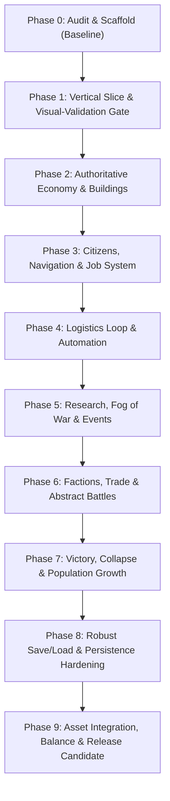

# KINGDOMS UNBOUND — Phased Implementation Plan & Dependency Roadmap

## Document Overview
- **Status:** Active Execution Plan
- **Authority:** Operationalizes `MASTER_PROMPT.md` and `docs/GDD.md` Phần XVIII.
- **Rules:** Work strictly in the currently authorized phase. Complete validation and verify exit criteria before advancing to the next phase.

---

## 1. Phase Mapping & Execution Roadmap

| Technical Phase | GDD Giai đoạn | Scope & Focus | Prerequisites | Exit Gate Criteria |
|---|---|---|---|---|
| **Phase 0** | Giai đoạn 0 | Scaffold, doc suite, live MCP, baseline validation | None | Project opens, parses, launches cleanly; baseline validation recorded. |
| **Phase 1** | Giai đoạn 1 | World gen (64×64), 2:1 isometric diamond tiles (32×16), camera, time controls, UI HUD, Visual-Validation Gate scene | Phase 0 | Map rendered, seed reproducible, time pause/speeds work, Visual-Validation Gate passed. |
| **Phase 2** | Giai đoạn 2 | Authoritative `ResourceManager`, building costs, placement validation, starter buildings | Phase 1 | Costs charged once, atomic reservations, no double-spending, store capacities enforced. |
| **Phase 3** | Giai đoạn 3 | 24 citizens, grid pathfinding (A*), job state machine, needs (Hunger, Fatigue, Health, Morale) | Phase 2 | Citizens navigate, claim/complete jobs, release claims, explainable idle states. |
| **Phase 4** | Giai đoạn 4 | Farm/Woodcutter output, physical hauling, starvation pacing, basic rule-based automation | Phase 3 | Logistics loop operates without teleportation; low-food rules trigger cleanly. |
| **Phase 5** | Giai đoạn 5 | Research tree (4 branches), Fog of War, exploration POIs, world events | Phase 4 | Research pauses correctly; POI discovery gives persistent rewards; event cooldowns work. |
| **Phase 6** | Giai đoạn 6 | Factions (2 rivals, 1 neutral), trade offers, atomic exchange, deterministic `BattleResolver` | Phase 5 | Trade cannot duplicate goods/gold; battle formulas produce explainable results. |
| **Phase 7** | Giai đoạn 7a | Immigration pacing, 5-day prosperity victory hold, collapse failure states, summary screens | Phase 6 | 30 population reachable; victory timer resets if broken; collapse explains cause. |
| **Phase 8** | Giai đoạn 7b | Atomic save/load, schema v1, corruption safety, save $\to$ load $\to$ save equivalence | Phase 7 | Zero duplicated citizens/buildings; corrupted fixture fails gracefully. |
| **Phase 9** | Giai đoạn 8 | Asset style guide integration, 27-color palette sprites, audio, balance, stress test (100 citizens) | Phase 8 | Complete playable MVP loop; flawless Y-sorting; release instructions verified. |

---

## 2. Detailed Phase Breakdown

### Phase 0: Audit, Scaffold & Reproducibility (Current Phase)
- **Tasks:**
  1. Lightweight MCP status verification & non-destructive recovery $\to$ **Completed** (MCP live on port 6505).
  2. Add `.gdignore` to `docs/` to isolate non-game documentation $\to$ **Completed**.
  3. Author comprehensive tracking document suite (`SCOPE_DECISIONS.md`, `GAME_RULES.md`, `ARCHITECTURE.md`, `IMPLEMENTATION_PLAN.md`, `TEST_PLAN.md`, `BACKLOG.md`, `KNOWN_ISSUES.md`, `CHANGELOG.md`, `NIGHTLY_REPORT.md`).
  4. Verify `MCPRuntime` autoload configuration in `project.godot`.
  5. Run real baseline validation using `Godot_v4.7-stable_win64_console.exe`.
  6. Git checkpoint Phase 0.
- **Exit Gate:** Project imports, opens, and passes headless check with 0 errors.

### Phase 1: Vertical Slice, World, Camera, Time & Visual-Validation Gate
- **Tasks:**
  1. Main menu scene (`MainMenu.tscn`): New World, Settings, Quit.
  2. World Generation (`WorldGenerator.gd`): 64×64 logical grid with seeded procedural elevation/biomes.
  3. Presentation Layer (`WorldView.tscn`): 2:1 dimetric isometric diamond ground tiles (32×16 px).
  4. Initial structures placed at valid coordinates: Town Hall (3×3), 4 Houses (2×2), Farm (2×2), Storehouse (2×2), Woodcutter Camp (2×2).
  5. Camera Controller (`CameraController.gd`): Pan (WASD/Middle Mouse), Zoom (Wheel), clamped to 64×64 map bounding polygon.
  6. Central `TimeManager.gd`: 0× (Pause), 1×, 2×, 3× speeds, hourly/daily ticks.
  7. Interactive mouse-hover diamond tile cursor highlight using exact inverse projection.
  8. **Visual-Validation Gate Scene (`res://scenes/test/visual_validation_test.tscn`):**
     - 32×16 diamond ground terrain.
     - Isometric props (trees, rocks).
     - Multi-tile building with visible rooftop and SW/SE facades.
     - 1 moving citizen with foot pivot at $(12, 30)$.
     - Flawless Y-sorting behind and in front of building/props.
- **Exit Gate:** World navigable, seed reproducible, time pause halts all progress, Visual-Validation Gate scene passes inspection.

### Phase 2: Authoritative Resources, Buildings & Economy
- **Tasks:**
  1. Resource data definitions and `ResourceManager.gd` ledger.
  2. Building data configuration (`BuildingData.gd`, costs, footprints, buffers).
  3. Building placement validation system (collision, terrain, resources).
  4. Initial inventory setup ($150$ food, $120$ wood, $60$ stone, $200$ gold, etc.).
  5. Economy HUD displaying resources, capacities, and daily rate projections.
- **Exit Gate:** Automated test verifying build costs charged once, invalid placements fail safely, and no double-spending.

### Phase 3: Citizens, Navigation & Real Jobs
- **Tasks:**
  1. Citizen entity scene & controller (`Citizen.tscn`, `CitizenController.gd`).
  2. Spawn 24 citizens with stable unique IDs.
  3. Starter job allocation (5 farmers, 4 woodcutters, 3 builders, 3 haulers, 9 idle).
  4. Grid A* navigation (`GridNavigation.gd`).
  5. Job state machine & `JobManager.gd`.
  6. Citizen needs decay & hourly tick (Hunger, Fatigue, Health, Morale).
- **Exit Gate:** Citizens pathfind to real targets, complete jobs, release reservations, with zero stuck loops.

### Phase 4: Logistics Loop & Automation
- **Tasks:**
  1. Physical hauling loop from local buffers to Storehouse/Town Hall.
  2. Seasonal agriculture balance and winter output modifier ($0.5\times$).
  3. Starvation escalation rules (no instant death).
  4. Configurable condition-action automation rules with execution budget.
- **Exit Gate:** Logistics loop moves materials physically; automation prioritizes food when critical.

### Phase 5: Research, Exploration & Events
- **Tasks:**
  1. 4 research branches with data-driven technologies.
  2. Fog of War (Unexplored, Explored, Visible).
  3. Points of Interest on map granting persistent rewards.
  4. World events with triggers and cooldowns.
- **Exit Gate:** Research progresses only when unpaused; POI rewards cannot be duplicated.

### Phase 6: Factions, Diplomacy, Trade & Combat
- **Tasks:**
  1. 2 rival factions + 1 neutral faction with deterministic state.
  2. Periodic trading caravans with finite stock and capacity validation.
  3. Deterministic `BattleResolver.gd`.
- **Exit Gate:** Trades cannot duplicate funds/goods; battle outcomes are explainable and deterministic.

### Phase 7: Population Growth, Victory & Collapse
- **Tasks:**
  1. Immigration arrival logic (housing, food, stability gating).
  2. 5-day continuous prosperity victory hold check.
  3. Deterministic collapse failure states (population 0, town hall lost, prolonged anarchy).
  4. World summary screens for victory and defeat.
- **Exit Gate:** Population can expand to 30; victory resets if conditions fail; collapse is explainable.

### Phase 8: Robust Save/Load & Persistence Hardening
- **Tasks:**
  1. Versioned JSON schema serialization.
  2. Atomic write with `.tmp` and `.bak` backups.
  3. Complete entity reconstruction without duplicating nodes or resetting world generation.
  4. Corruption validation and recovery.
- **Exit Gate:** Save $\to$ Load $\to$ Save equivalence test passes.

### Phase 9: Polish, Style Guide Asset Integration & Balance
- **Tasks:**
  1. Integrate final 27-color palette pixel assets conforming to `docs/ASSET_STYLE_GUIDE.md`.
  2. Sound effects and ambient music.
  3. Performance stress test with 100 citizens.
  4. Windows release export instructions and smoke test.
- **Exit Gate:** Fully playable, visually cohesive MVP meeting all GDD acceptance criteria.
