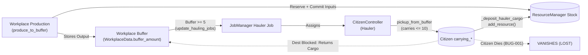
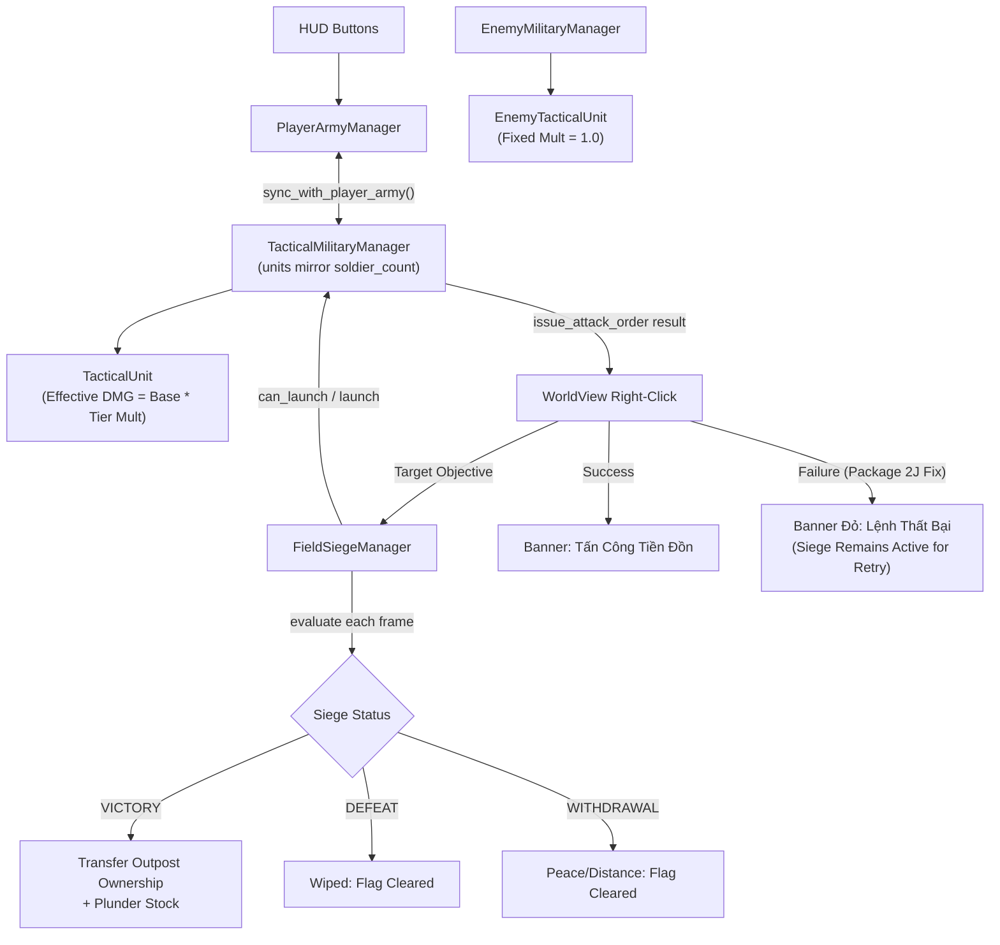

# SYSTEM MAP — KINGDOMS UNBOUND (REVISED V2)

> **Last Verified:** 2026-11-07 against committed Baseline HEAD `4a99322a6d2efb6bc269914f68d2968734d4b678`.
> Complements `docs/ARCHITECTURE.md` (Phase-0 design intent). If this document and source code disagree, source code is authoritative; update this document.

---

## 1. Entry Points and Autoload Singletons (`project.godot`)

- **Main Scene:** `res://scenes/ui/main_menu.tscn` (`scripts/ui/main_menu.gd`) $\rightarrow$ transitions to `scenes/world/world_view.tscn`.
- **Engine Autoload Singletons:** `project.godot` registers **exactly five Autoload Node Singletons**:

| Autoload Name | File Path | Subsystem Role & Core Signals |
|:---|:---|:---|
| **`MCPRuntime`** | `addons/godot_mcp/runtime/mcp_runtime.gd` | Third-party tooling & IDE agent integration runtime. |
| **`TimeManager`** | `scripts/core/time_manager.gd` | Game clock & speed scaling. Emits `hour_passed(hour, day)`, `day_passed(day, season, year)`, `season_changed`, `year_passed`. (24 h/day, 10 d/season, 40 d/year). |
| **`ResourceManager`** | `scripts/economy/resource_manager.gd` | **Authoritative central stock ledger.** Handles reserve, commit, release, capacity enforcement, daily food upkeep on `day_passed`. |
| **`EventManager`** | `scripts/core/event_manager.gd` | Decoupled event router (`event_triggered`, `poi_discovered`, `tech_unlocked`) and event history buffer. |
| **`AudioManager`** | `scripts/audio/audio_manager.gd` | Procedural 16-bit PCM waveform synthesis for UI, construction, fanfares, alarms, and music. |

> *Note on Historical Counts:* Previous reports that listed "three autoloads" referred strictly to the core gameplay simulation managers (`TimeManager`, `ResourceManager`, `EventManager`), omitting the tooling singleton (`MCPRuntime`) and the audio presentation singleton (`AudioManager`). All five exist as registered Node singletons under `/root/`.

### 1.1 `WorldView` Composition Root (Non-Autoload Managers)
All other gameplay managers are **non-autoload `RefCounted` instances** instantiated and owned by `WorldView` in `_generate_and_build_world()` (`scripts/world/world_view.gd` L193–292). There is no global registry; managers reference each other via constructor injection or explicit setters:
- **RefCounted Managers:** `JobManager`, `WorkplaceManager`, `AutomationManager`, `ResearchManager`, `FogOfWar`, `POIManager`, `WorldEventSystem`, `FactionManager`, `ImmigrationManager`, `VictoryManager`, `BattleCampaignManager`, `PlayerArmyManager`, `TacticalMilitaryManager`, `EnemyMilitaryManager`, `FieldSiegeManager`, `WorldData`, and `GridNavigation`.
- **Node Presentation Children:** `building_highlight` (Node2D), `army_marker` (Node2D), `caravan_marker` (Node2D), `ghost_building_node` (Node2D).
- **Static Class Utilities:** `BuildingSystem` (`scripts/economy/building_system.gd`), `EconomyConfig` (`scripts/economy/economy_config.gd`), `IsoMath` (`scripts/world/iso_math.gd`), `SaveManager` (`scripts/persistence/save_manager.gd`), `BattleResolver` (`scripts/combat/battle_resolver.gd`).

---

## 2. Data Ownership Map (Single Source of Truth)

| Domain | Authoritative Owner | Key Data Structures | Critical Architecture Rules |
|:---|:---|:---|:---|
| **Central Stock & Capacities** | `ResourceManager` | `_current_stock`, `_reserved_stock`, `_capacities`, `_is_starving` | `active_population` is pushed in by `WorldView` (`citizen_list.size()`). Stock modifications must use `reserve_cost` $\rightarrow$ `commit_cost` or `add_resources_atomic`. |
| **Workplace Output Buffers** | `WorkplaceManager` | `_workplaces[ch_id]["buffer_amount"]` | Output buffers are **not** central stock. Goods become central stock only when delivered to storage by a hauler. |
| **Carried Hauler Cargo** | `CitizenController` | `carrying_resource`, `carrying_amount`, `carrying_source_workplace_id` | Carried cargo resides strictly in citizen variables ($\le 10$). Bounded by `BUG-001` (lost on death). |
| **Buildings & Occupancy** | `WorldView.world_data` | `world_data.buildings`, `world_data.occupancy` | Mutated exclusively through static `BuildingSystem` functions. |
| **Job State Machine** | `JobManager` | `_jobs: Array[JobData]` | Rebuilt on save load via `sync_workplaces_after_load()`; dynamic jobs are not serialized. Terminal jobs accumulate (`BUG-002`). |
| **Citizens (Entities)** | `WorldView` | `citizen_list`, `citizens_by_id`, `deceased_citizen_ids` | Each citizen node owns hunger, fatigue, health, morale, skills, and role. |
| **Strategic Player Army** | `PlayerArmyManager` | `soldier_count`, `equipment_tier`, `movement_state`, `current_cell`, `rally_cell` | `equipment_tier` (1..3) is the **sole authority** for player military equipment. |
| **Player Tactical Units** | `TacticalMilitaryManager` | `units: Array[TacticalUnit]` | Mirrored from `PlayerArmyManager.get_army_count()` via `sync_with_player_army()`. |
| **Enemy Units & AI** | `EnemyMilitaryManager` | `enemy_units: Array[EnemyTacticalUnit]` | Multiplier is fixed at 1.0 (does not use player equipment tier). |
| **Sieges & Outposts** | `FieldSiegeManager` | `objectives`, `active_sieges` | Outpost ownership transfers via `transfer_outpost_ownership()`. |
| **Factions & Relations** | `FactionManager` | `_factions`, `_pairwise_relations`, `_last_action_day_by_faction` | Strategy/diplomacy planners are pure helpers; state changes emit signals. |
| **Raids & Campaigns** | `BattleCampaignManager` | `_pending_raids`, `_pending_inter_faction_campaigns` | Deterministic seeds derived from `world_seed`, day, faction hash, and sequence. |
| **Simulation Calendar** | `TimeManager` | `current_day`, `current_hour`, `season_index`, `current_year` | Real-time seconds convert to game hours via accumulator. |

---

## 3. Simulation Execution & Tick Chains

### 3.1 Day Rollover Signal Sequence (`day_passed`)
`TimeManager._advance_one_hour()` detects hour rollover to 24 $\rightarrow$ increments day $\rightarrow$ emits `hour_passed` $\rightarrow$ emits `day_passed`.
1. **`ResourceManager._on_day_passed` (Autoload - Executes 1st):**
   - Deducts daily food upkeep ($1\text{ food/citizen/day}$, or starvation triggers).
   - Rotates daily production and consumption ledgers.
2. **`HUD._on_day_passed` (Executes 2nd):**
   - Updates date and season UI labels.
3. **`WorldView._on_simulation_day_passed` (Executes 3rd, L2429–2478):**
   - `WorldEventSystem.update_daily_modifiers(day)` and checks event triggers.
   - `FactionManager.update_daily_simulation(day)`: AI evaluates diplomatic actions.
   - `PlayerArmyManager.process_daily_upkeep(day)`: Deducts army food upkeep.
   - `BattleCampaignManager.process_daily_raids(day)`: Resolves scheduled settlement raids.
   - Trade caravan arrivals / departures (every 5 days, starting Day 3).
   - **Autosave:** `SaveManager.save_to_file(self)` every `autosave_interval_days` (overwrites `world_save.json`, see `BUG-003`).

### 3.2 Hourly Simulation Chain (`hour_passed`)
- `WorldView._on_simulation_hour_passed` (L2366–2428):
  - Progresses active research (`ResearchManager.progress_research`).
  - Refreshes Fog of War and vision sightlines (`refresh_world_vision`).
  - Checks POI proximity reward claims.
  - Generates hauler jobs from workplace buffers $\ge 5$ (`workplace_mgr.update_hauling_jobs`).
  - Evaluates automation rules (`automation_mgr.evaluate_rules`).
  - Evaluates hourly immigration wave eligibility (`immigration_mgr.evaluate_immigration`).
  - Evaluates victory and collapse conditions (`victory_mgr.tick_hourly`).
- Simultaneously, all living `CitizenController` instances receive `hour_passed` to update biological needs.

### 3.3 Per-Frame Processing (`_process`)
- Military movement runs on real-time `delta * speed`, completely independent of `TimeManager` hours.
- `WorldView._process()` continuously evaluates all active sieges via `field_siege_mgr.evaluate_siege_status()`.

---

## 4. Economy & Workplace Logistics Data Flow

---

## 5. Army, Equipment & Combat Lifecycle

---

## 6. Save / Load Architecture (`scripts/persistence/save_manager.gd`)

`SaveManager.apply_loaded_state_to_world()` executes an atomic-style 24-step restoration:
1. **Validation & Military Preflight (L1738, L1743):** Strict type/range validation. Fails closed.
2. **Pre-Load Snapshotting (L1750):** Serializes current state (`pre_load_snapshot`) for automatic recursive rollback if later deserialization fails.
3. **Clock & Calendar Restoration (L1778):** Restores day, hour, and deterministically derives season/year for legacy saves lacking those fields.
4. **Resource Ledger Reset (L1815):** Calls `reset_economy()`, restores stock, capacities, active population, and starvation flag.
5. **Building Reconstruction (L1834):** Cleans old building nodes via `remove_child()` + `queue_free()`, clears occupancy, rebuilds blueprints.
6. **Workplace Logistics Sync (L1897):** Calls `sync_workplaces_after_load()`, clears dynamic jobs, restores output buffers.
7. **Citizen Reconstruction (L1902):** Frees old citizen nodes (preserving `ArmyMarker`), reconstructs controllers, restores needs, carrying cargo, and skills.
8. **Immigration, Events & Research (L1958–1987):** Restores immigration cooldowns, event modifiers, and active tech progress.
9. **Victory & Treasury Recovery (L1988–2041):** Cross-file crash recovery: if treasury was converted in profile but save crashed, automatically deducts gold.
10. **Factions & Relations (L2042–2100):** Restores faction attributes, pairwise relations, and executor state.
11. **Military & Tactical Restorations with Rollback (L2144–2236):** Deserializes campaigns, player army, tactical military, enemy military, and field sieges. **If any military system fails to deserialize, world state is rolled back to pre-load snapshot!**
12. **Target Resolution & Vision Refresh (L2238–2250):** Resolves combat targets only after all units and objectives exist; recomputes active Fog of War sightlines.
13. **Caravan Restoration (L2252):** Restores active trade caravans and map markers.
