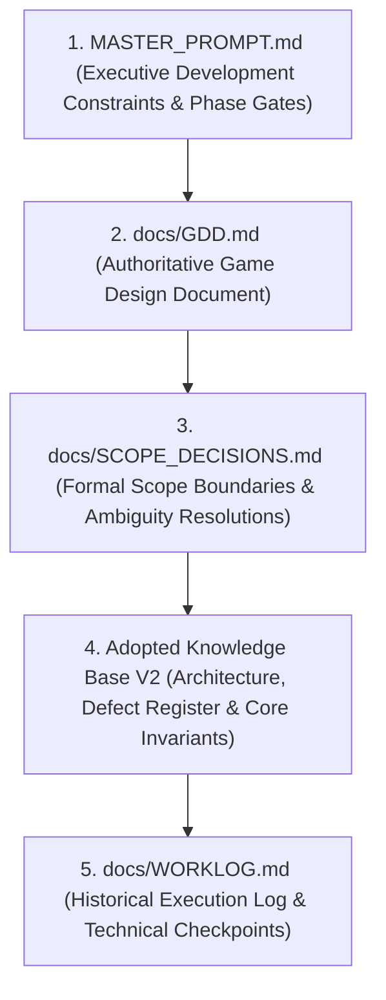

# KINGDOMS UNBOUND — GAME COMPLETION ROADMAP
**Document Authority:** Authoritative Planning Reference  
**Baseline Engine:** Godot 4.7-stable  
**Current Baseline Commit:** `ad5c9e5` (`feature/core-systems-hardening`)  
**Knowledge Base:** Revised Knowledge Base V2 Adopted  

---

## 1. PRODUCT SCOPE & DOCUMENT PRECEDENCE

When design, specification, or implementation requirements conflict, the following strict hierarchy of authority governs the project:

### Core Non-Negotiable Boundaries:
1. **Single-Player Offline 2D Isometric Colony Sim / RTS:** Built natively in Godot 4.7-stable, featuring a 64×64 diamond tile simulation grid (32×16 px tiles, dimetric 2:1 slope, Y-sorting enabled).
2. **Vietnamese Player-Facing Localization:** All in-game HUD readouts, event banners, menus, dialogs, inspectors, and tooltips are localized in natural Vietnamese. All internal source code, APIs, variables, comments, and debug logs remain in standard English.
3. **No Unilateral Feature Expansion:** Features not specified in `docs/GDD.md` or formally ratified in `docs/SCOPE_DECISIONS.md` must not be invented.

---

## 2. 5-TIER FIDELITY EVALUATION FRAMEWORK

To prevent declaring features "complete" merely because underlying data models or headless tests pass, every gameplay domain is evaluated across 5 distinct fidelity tiers:

| Tier | Level Name | Definition & Verification Requirement |
|:---:|:---|:---|
| **T1** | **Data / API Foundation** | Data models, properties, dictionaries, and serialization methods exist. |
| **T2** | **Backend Simulation** | State machines, simulation math, resource consumption, and ticks execute correctly. |
| **T3** | **Player UI Interaction** | Interactive HUD elements, buttons, menus, and inspector panels allow player interaction. |
| **T4** | **Natural Gameplay Loop** | System integrates seamlessly with surrounding simulation loops (economy, time, AI, map). |
| **T5** | **End-to-End Acceptance** | Complete player experience verified via headless tests, live GUI acceptance, and save/load persistence. |

---

## 3. COMPREHENSIVE FEATURE COVERAGE MATRIX

Legend:
- **Status:** `IMPLEMENTED` (T1–T5 verified) | `PARTIAL` (T1–T3 exists, loop/UX incomplete) | `MISSING` (Not yet implemented) | `DEFERRED` (Explicitly post-MVP) | `NEEDS DECISION` (Owner product choice required).
- **Complexity:** `S` (<1 day), `M` (1–2 days), `L` (3–4 days), `XL` (5+ days).
- **Blocker:** Whether this item blocks declaring the MVP a complete, shippable game.

### Domain A: World & Simulation Foundation
| Feature & Requirement | GDD Ref | Production Source | Test & Verification Evidence | Status | Fidelity | Deps | Size | Blocker? |
|:---|:---:|:---|:---|:---:|:---:|:---|:---:|:---:|
| 64×64 Isometric Grid & Coordinate Math | §3.1 | `scripts/coordinates/iso_math.gd` | `test_coordinates.gd` (13/13 PASS) | IMPLEMENTED | T1–T5 | None | S | No |
| Procedural World Gen with Seed | §3.3 | `scripts/world/world_generator.gd` | `test_world_gen.gd` (10/10 PASS) | IMPLEMENTED | T1–T5 | IsoMath | M | No |
| 4 Terrain Types (Grass, Forest, Mountain, Water) | §3.2 | `scripts/world/world_data.gd` | `test_world_gen.gd` | IMPLEMENTED | T1–T5 | WorldGen | S | No |
| Dynamic Fog of War (Unexplored, Explored, Visible) | §3.4 | `scripts/world/fog_of_war.gd` | `test_save_load.gd` (GATE-B.4-6) | IMPLEMENTED | T1–T5 | IsoMath | M | No |
| Game Clock, Day/Night, 4 Seasons, Speeds 0x–3x | §4.1 | `scripts/core/time_manager.gd` | `test_time_manager.gd` (PASS) | IMPLEMENTED | T1–T5 | None | M | No |
| Daily/Seasonal Accounting Ticks & Upkeep | §4.2 | `scripts/world/world_view.gd` | `test_save_load.gd`, `test_economy.gd` | IMPLEMENTED | T1–T5 | TimeMgr | M | No |
| Multi-Slot Persistence & Atomic Crash Recovery | §15.1 | `scripts/persistence/save_manager.gd` | `test_save_load.gd`, `test_save_slot_isolation.gd` | IMPLEMENTED | T1–T5 | All mgrs | L | No |
| Repeated Scene-Tree Cleanup (RISK-005) | §15.2 | `scripts/persistence/save_manager.gd` | `test_repeated_save_load_scene_cleanup.gd` (38/38) | IMPLEMENTED | T1–T5 | SaveMgr | S | No |

### Domain B: Economy & Logistics
| Feature & Requirement | GDD Ref | Production Source | Test & Verification Evidence | Status | Fidelity | Deps | Size | Blocker? |
|:---|:---:|:---|:---|:---:|:---:|:---|:---:|:---:|
| 8 Core Resources + Gold Treasury Ledger | §5.1 | `scripts/economy/resource_manager.gd` | `test_economy.gd`, `test_gold_transactions.gd` | IMPLEMENTED | T1–T5 | None | M | No |
| Starting Inventory & Housing Allocation | §5.2 | `scripts/economy/economy_config.gd` | `test_citizens.gd`, `test_save_load.gd` | IMPLEMENTED | T1–T5 | Config | S | No |
| Strict Resource Transactions (RISK-001) | §5.1 | `scripts/economy/resource_manager.gd` | `test_resource_transaction_integrity.gd` (88/88) | IMPLEMENTED | T1–T5 | ResMgr | M | No |
| Workplace Local Buffers & Anti-Teleportation | §5.4 | `scripts/economy/workplace_manager.gd` | `test_dynamic_workplaces.gd` (PASS) | IMPLEMENTED | T1–T5 | ResMgr | M | No |
| Physical Citizen Hauling & Buffer Clearing | §8.1 | `scripts/entities/citizen_controller.gd` | `test_dynamic_workplaces.gd`, `test_logistics.gd` | IMPLEMENTED | T1–T5 | Nav, Jobs | L | No |
| Hauler Death Cargo Conservation (BUG-001) | §5.5 | `scripts/entities/citizen_controller.gd` | `test_hauler_death_cargo_conservation.gd` (12/12) | IMPLEMENTED | T1–T5 | WorldView | M | No |
| Multi-Tier Production Chains (Ore->Metal->Tools) | §5.1 | `scripts/economy/workplace_manager.gd` | `test_workshop.gd` (PASS) | IMPLEMENTED | T1–T5 | Workplaces | M | No |
| Storehouse Capacity & Non-Destructive Demolition | §5.5 | `scripts/economy/resource_manager.gd` | `test_building_management.gd` (TC-BM.48) | IMPLEMENTED | T1–T5 | Buildings | M | No |
| Market 3×3 & Visiting Merchant Physical Docking | §11.1 | `scripts/trade/trade_caravan.gd` | `test_market.gd` (PASS) | IMPLEMENTED | T1–T5 | WorldView | M | No |
| Dynamic Market Pricing Elasticity [0.80, 1.20] | §11.2 | `scripts/trade/trade_caravan.gd` | `test_market.gd` (Package 2H) | IMPLEMENTED | T1–T5 | ResMgr | M | No |
| Emergency Trade Price Markup (25%) | §11.2 | N/A | Excluded in `SCOPE_DECISIONS.md §1.28` | DEFERRED | N/A | None | S | No |

### Domain C: Citizen Simulation
| Feature & Requirement | GDD Ref | Production Source | Test & Verification Evidence | Status | Fidelity | Deps | Size | Blocker? |
|:---|:---:|:---|:---|:---:|:---:|:---|:---:|:---:|
| 24 Starting Citizens with Individual Stats | §6.1 | `scripts/entities/citizen_controller.gd` | `test_citizens.gd` (TC-3.1) | IMPLEMENTED | T1–T5 | WorldGen | M | No |
| Hunger, Fatigue, Health, Morale Needs Decay | §6.2 | `scripts/entities/citizen_controller.gd` | `test_citizens.gd` | IMPLEMENTED | T1–T5 | TimeMgr | M | No |
| 6 Core Vocations & Autonomous Job Allocation | §6.3 | `scripts/jobs/job_manager.gd` | `test_citizens.gd`, `test_dynamic_workplaces.gd` | IMPLEMENTED | T1–T5 | JobMgr | L | No |
| Vocational Skill Progression (XP & 1.00x–1.35x) | §6.5 | `scripts/entities/citizen_skill_data.gd` | `test_citizen_skills.gd` (PASS) | IMPLEMENTED | T1–T5 | Citizens | M | No |
| Deterministic Immigration Gating (Housing/Food/Stab) | §6.7 | `scripts/world/immigration_manager.gd` | `test_save_load.gd` (GATE-B) | IMPLEMENTED | T1–T5 | Buildings | M | No |
| Starvation Escalation (Stages 1–3) & Combat Death | §5.3 | `scripts/entities/citizen_controller.gd` | `test_citizens.gd`, `test_live_battle_loop.gd` | IMPLEMENTED | T1–T5 | ResMgr | M | No |
| Individual Citizen Inspector & Role Reassignment | §14.4 | `scripts/ui/hud.gd` (`CitizenInspectPanel`) | `test_building_management.gd` (TC-BM.11) | IMPLEMENTED | T1–T5 | HUD | M | No |
| **Manual Citizen Commands (Move/Chop/Mine/Build/Haul/Explore)** | **§8.2, §8.3** | `scripts/entities/citizen_controller.gd`, `scripts/world/world_view.gd` | `test_manual_citizen_commands.gd` (239/239 PASS) | IMPLEMENTED | T1–T3 (T4–T5 Pending Live GUI) | Citizen, Nav | M | No |
| Settlement-Wide Citizen Roster Table (Macro View) | §14.4 | `scripts/ui/hud.gd`, `scenes/ui/hud.tscn` | `test_citizen_roster.gd` (104/104 PASS) | IMPLEMENTED | T1–T3 (T4–T5 Pending Live GUI) | HUD | M | No |
| Complex Family Trees & Genetic Breeding | §2.2 | N/A | Excluded in `SCOPE_DECISIONS.md §1.4` | DEFERRED | N/A | None | XL | No |

### Domain D: Construction & Settlement Development
| Feature & Requirement | GDD Ref | Production Source | Test & Verification Evidence | Status | Fidelity | Deps | Size | Blocker? |
|:---|:---:|:---|:---|:---:|:---|:---|:---:|:---:|
| 12 Constructible Blueprints (1×1, 2×2, 3×3) | §7.1 | `scripts/economy/economy_config.gd` | `test_construction.gd`, `test_building_management.gd` | IMPLEMENTED | T1–T5 | BuildSys | L | No |
| Isometric Footprint Validation & Access Cell Gating | §7.3 | `scripts/economy/building_system.gd` | `test_construction.gd`, `test_dynamic_workplaces.gd` | IMPLEMENTED | T1–T5 | IsoMath | M | No |
| Physical Builder Construction Progress (0%->100%) | §7.3 | `scripts/entities/citizen_controller.gd` | `test_construction.gd`, `test_citizen_skills.gd` | IMPLEMENTED | T1–T5 | Jobs | M | No |
| Fail-Closed Construction Cancellation (50% Refund) | §7.3 | `scripts/economy/building_system.gd` | `test_building_management.gd` (TC-BM.14-16) | IMPLEMENTED | T1–T5 | ResMgr | M | No |
| Safe Demolition & 72h Town Hall Collapse Grace | §12.1 | `scripts/world/world_view.gd` | `test_building_management.gd` (TC-BM.17-22) | IMPLEMENTED | T1–T5 | VictoryMgr | M | No |
| Building Operational Pause/Resume Lifecycle | §7.2 | `scripts/world/world_view.gd` | `test_building_management.gd` (TC-BM.23-29) | IMPLEMENTED | T1–T5 | Workplaces | M | No |
| 3-Tier Upgrades (House, Farm, Storehouse) | §7.1 | `scripts/economy/building_system.gd` | `test_building_management.gd` (TC-BM.35-53) | IMPLEMENTED | T1–T5 | Builders | L | No |
| Civic Building Damage & Maintenance Repair Loop | §7.2 | `scripts/world/world_view.gd`, `scripts/economy/building_system.gd` | `test_building_damage_repair.gd` (25/25), `test_player_army.gd` (TC-ARMY.32) | IMPLEMENTED | T1–T3 (T4–T5 Pending Live GUI) | BuildSys | S | No |

### Domain E: Military & Warfare
| Feature & Requirement | GDD Ref | Production Source | Test & Verification Evidence | Status | Fidelity | Deps | Size | Blocker? |
|:---|:---:|:---|:---|:---:|:---|:---|:---:|:---:|
| Barracks Recruitment & Upkeep (1 Food/soldier) | §10.4 | `scripts/military/player_army_manager.gd` | `test_player_army.gd`, `test_barracks.gd` | IMPLEMENTED | T1–T5 | Barracks | M | No |
| 3-Tier Equipment Multipliers (1.00x, 1.25x, 1.50x) | §10.4 | `scripts/military/player_army_manager.gd` | `test_army_equipment.gd` (10/10 PASS) | IMPLEMENTED | T1–T5 | ResMgr | M | No |
| Tactical Unit Actors, Formations & Control Groups | §10.4 | `scripts/military/tactical_military_manager.gd` | `test_tactical_military.gd`, `test_army_movement.gd` | IMPLEMENTED | T1–T5 | Nav, Camera | L | No |
| Real-Time Tactical Combat & Health Bars | §10.4 | `scripts/military/tactical_unit.gd` | `test_tactical_combat.gd` (58/58 PASS) | IMPLEMENTED | T1–T5 | Units | L | No |
| Deterministic Enemy AI State Machine (Crimson Mod) | §10.4 | `scripts/military/enemy_tactical_unit.gd` | `test_enemy_military_ai.gd` (54/54 PASS) | IMPLEMENTED | T1–T5 | Nav | L | No |
| Settlement Defense vs Periodic Enemy Raids | §10.4 | `scripts/combat/battle_campaign_manager.gd` | `test_live_battle_loop.gd`, `test_factions_and_battles.gd` | IMPLEMENTED | T1–T5 | Factions | L | No |
| Player Offensive Campaigns & Battle Resolver | §10.4 | `scripts/combat/battle_campaign_manager.gd` | `test_offensive_campaign.gd`, `test_campaign_result_feedback.gd` | IMPLEMENTED | T1–T5 | ArmyMgr | L | No |
| Field Siege Operations & Outpost Capture (35% HP) | §10.1 | `scripts/combat/field_siege_manager.gd` | `test_field_siege.gd` (98/98), `test_outpost_territorial_control.gd` | IMPLEMENTED | T1–T5 | WorldView | L | No |
| Bounded Resolved Siege Records (RISK-002) | §10.1 | `scripts/combat/field_siege_manager.gd` | `test_siege_record_lifecycle.gd` (51/51 PASS) | IMPLEMENTED | T1–T5 | SaveMgr | S | No |
| Defensive Fortifications (Palisade & Watchtower) | §7.1 | `scripts/world/world_view.gd` | `test_palisade.gd`, `test_watchtower.gd` | IMPLEMENTED | T1–T5 | FoW | M | No |

### Domain F: Faction & Diplomacy Simulation
| Feature & Requirement | GDD Ref | Production Source | Test & Verification Evidence | Status | Fidelity | Deps | Size | Blocker? |
|:---|:---:|:---|:---|:---:|:---|:---|:---:|:---:|
| 3 Initial Factions + Profiles (Goals & Statuses) | §10.1 | `scripts/factions/faction_data.gd` | `test_faction_profiles.gd` (PASS) | IMPLEMENTED | T1–T5 | Config | M | No |
| Dynamic Opinion, Dispositions, Treaties & Alliances | §10.2 | `scripts/factions/faction_manager.gd` | `test_factions_and_battles.gd` | IMPLEMENTED | T1–T5 | Factions | M | No |
| Neutral Tribe Ascension Gate (Liên Minh Rừng Thiêng) | §10.3 | `scripts/factions/faction_manager.gd` | `test_emerging_faction_ascension.gd` | IMPLEMENTED | T1–T5 | TimeMgr | M | No |
| Deterministic Strategic Intent Planner & Executor | §10.1 | `scripts/factions/faction_strategy_executor.gd` | `test_faction_strategy_execution.gd` | IMPLEMENTED | T1–T5 | Factions | L | No |
| Autonomous Pairwise NPC-NPC Warfare & Truces | §10.2 | `scripts/factions/faction_diplomacy_planner.gd` | `test_autonomous_faction_conflict.gd` (Package 2E) | IMPLEMENTED | T1–T5 | Battles | L | No |
| Pairwise NPC-NPC Diplomacy UI (Section 3) | §14.4 | `scripts/ui/hud.gd` (`DiplomacyPanel`) | `test_autonomous_faction_conflict.gd` | IMPLEMENTED | T1–T5 | HUD | M | No |
| Government in Exile & Full Faction Elimination | §10.5 | `scripts/factions/faction_data.gd` | Data model verified; full map elimination deferred | DEFERRED | T1–T2 | Outposts | XL | No |

### Domain G: Research & Exploration
| Feature & Requirement | GDD Ref | Production Source | Test & Verification Evidence | Status | Fidelity | Deps | Size | Blocker? |
|:---|:---:|:---|:---|:---:|:---|:---|:---:|:---:|
| 10 Technologies in 4 Data-Driven Branches | §9.1 | `scripts/research/tech_tree.gd` | `test_research_and_exploration.gd` | IMPLEMENTED | T1–T5 | Config | M | No |
| Research Hall Construction & Researcher Labor | §9.3 | `scripts/research/research_manager.gd` | `test_research_hall.gd` (PASS) | IMPLEMENTED | T1–T5 | Builders | M | No |
| Passive Technology Bonus Application | §9.2 | `scripts/world/world_view.gd` | `test_research_and_exploration.gd` | IMPLEMENTED | T1–T5 | ResMgr | M | No |
| Points of Interest Generation (Ruins, Mines, Groves)| §9.4 | `scripts/world/poi_manager.gd` | `test_research_and_exploration.gd` | IMPLEMENTED | T1–T5 | WorldGen | M | No |
| **Active Player POI Scouting / Exploration Dispatch** | **§9.4** | **`scripts/world/world_view.gd`** | **Passive proximity check only (dist <= 2)** | **PARTIAL** | **T2–T3** | **ManualCmd** | **S** | **No** |

### Domain H: Victory, Collapse & Endgame
| Feature & Requirement | GDD Ref | Production Source | Test & Verification Evidence | Status | Fidelity | Deps | Size | Blocker? |
|:---|:---:|:---|:---|:---:|:---|:---|:---:|:---:|
| Prosperity Victory (5-Day Continuous Hold) | §12.3 | `scripts/world/victory_manager.gd` | `test_victory_and_collapse.gd` | IMPLEMENTED | T1–T5 | ResMgr, Time | L | No |
| 3 Deterministic Collapse States (Extinction/Ruin/Anarchy)| §12.1 | `scripts/world/victory_manager.gd` | `test_victory_and_collapse.gd` | IMPLEMENTED | T1–T5 | WorldView | M | No |
| Post-Victory Endless Freeplay Mode | §12.4 | `scripts/world/victory_manager.gd` | `test_victory_and_collapse.gd` | IMPLEMENTED | T1–T5 | HUD | S | No |
| Decoupled Meta-Progression Profile (`legacy_profile.json`)| §13.1 | `scripts/legacy/legacy_profile_manager.gd`| `test_legacy_fund.gd` (Package 1Z) | IMPLEMENTED | T1–T5 | Filesystem | L | No |
| Surplus Treasury Conversion (100:1, 1000 reserve) | §13.2 | `scripts/world/victory_manager.gd` | `test_surplus_treasury_conversion.gd` (2C) | IMPLEMENTED | T1–T5 | ProfileMgr | M | No |
| Multi-World Grand Campaign Mode | §1.1 | N/A | Excluded in `SCOPE_DECISIONS.md §1.9` | DEFERRED | N/A | None | XL | No |

### Domain I: Player Experience & UI/UX
| Feature & Requirement | GDD Ref | Production Source | Test & Verification Evidence | Status | Fidelity | Deps | Size | Blocker? |
|:---|:---:|:---|:---|:---:|:---|:---|:---:|:---:|
| Main Menu (New, Load, Help, Legacy Fund, Exit) | §14.1 | `scripts/ui/main_menu.gd` | `test_save_load.gd`, `test_legacy_fund.gd` | IMPLEMENTED | T1–T5 | SceneTree | M | No |
| TopBar Clock, Date, Speed Controls, Resources | §14.3 | `scripts/ui/hud.gd` | Visual validation tests, `test_save_load.gd` | IMPLEMENTED | T1–T5 | TimeMgr | M | No |
| BottomBar Actions (Build, Research, Diplomacy, Army) | §14.3 | `scripts/ui/hud.gd` | Visual validation tests, `test_responsive_layout.gd` | IMPLEMENTED | T1–T5 | Panels | M | No |
| In-Game Player Field Guide (6 Structured Chapters) | §1.2 | `scripts/ui/player_field_guide.gd` | `test_player_field_guide.gd` (Package 2D) | IMPLEMENTED | T1–T5 | HUD | M | No |
| Responsive Layout Scaling (1920×1080 to 1024×576) | §14.5 | `scripts/ui/hud.gd` | `test_responsive_layout.gd` (34/34 PASS) | IMPLEMENTED | T1–T5 | Viewport | M | No |
| Procedural 16-Bit PCM Waveform Audio System | §16.2 | `scripts/audio/audio_manager.gd` | `test_audio.gd` (PASS) | IMPLEMENTED | T1–T5 | Autoload | M | No |
| Interactive Visual Automation Graph Editor | §8.5 | `scripts/ui/automation_editor.gd` | `test_automation_graph.gd` (Package 1V, 1Y) | IMPLEMENTED | T1–T5 | GraphEdit | L | No |

### Domain J: Technical Completeness & Release Readiness
| Feature & Requirement | GDD Ref | Production Source | Test & Verification Evidence | Status | Fidelity | Deps | Size | Blocker? |
|:---|:---:|:---|:---|:---:|:---|:---|:---:|:---:|
| Versioned Save Schema & Fail-Closed Deserialization | §15.1 | `scripts/persistence/save_manager.gd` | `test_save_load.gd` (182/182 PASS) | IMPLEMENTED | T1–T5 | All mgrs | L | No |
| 62-Suite Headless Regression Runner | §17.6 | `scripts/test/run_regression.ps1` | 61 PASS, 1 Baseline FAIL, Exit Code 0 | IMPLEMENTED | T1–T5 | Godot CLI | M | No |
| 100-Citizen Stress Performance Invariant | §16.5 | `scripts/test/test_stress_100_citizens.gd`| 5.31s runtime, zero FPS freeze | IMPLEMENTED | T1–T5 | Entities | L | No |
| **Standalone Distribution Export Presets (`export_presets.cfg`)** | **§16.1** | **None (`project.godot` only)** | **Untracked build pipeline; manual run only** | **MISSING** | **T0** | **Godot CLI** | **S** | **YES** |

---

## 4. RECONCILED DEFECT, RISK & GAP BACKLOG

| ID | Domain | Classification | Description & Current Status | Severity |
|:---|:---:|:---:|:---|:---:|
| **BUG-001** | Economy | **CLOSED** | Hauler cargo destroyed on citizen death; resolved via `recover_cargo()` and `pending_death_cargo`. | High |
| **BUG-002** | Economy | **CLOSED** | JobManager memory leak; resolved via dynamic job pruning and bounded terminal history. | Medium |
| **BUG-003** | Persistence | **CLOSED** | Daily autosave overwrote manual save; resolved via dedicated `autosave.json` slot isolation. | High |
| **RISK-001** | Economy | **CLOSED** | ResourceManager lacked strict reservation matching; hardened with records & transaction ticket API. | High |
| **RISK-002** | Combat | **CLOSED** | Resolved field sieges accumulated in active loop; separated into bounded FIFO history (50 records). | Med-High |
| **RISK-003** | Military | **CLOSED** | EnemyTacticalUnit lacked initial faction guard; resolved via `_init()` setting `faction_id = "enemy"`. | Low |
| **RISK-004** | Diplomacy | **RESOLVED** | Faction `in_exile` and `eliminated` statuses; confirmed as intended GDD endgame campaign staging. | Low |
| **RISK-005** | Persistence | **CLOSED** | SaveManager freed citizens without `remove_child()`; resolved, eliminating node rename collisions. | Medium |
| **RISK-006** | Documentation | **CLOSED** | Documentation drift synchronized in commit `4a99322`. | Medium |
| **RISK-007** | Economy | **RESOLVED** | Stock exceeding capacity after demolition; confirmed as intentional non-destructive conservation (I-07). | Low |
| **RISK-008** | UI | **CLOSED** | Offensive campaign banner reported victory on defeat; resolved with truthful branching in `hud.gd`. | Med-High |
| **GAP-001** | Combat | **CLOSED** | Attack order failure path in WorldView lacked test; verified in `test_world_view_siege_input.gd`. | Medium |
| **GAP-002** | Regression | **CLOSED** | No reliable test runner; authored `scripts/test/run_regression.ps1` with raw exit codes. | Medium |
| **GAP-003a-c**| Economy/UI | **CLOSED** | Disaggregated and closed across BUG-001, BUG-002, and RISK-008 test suites. | Medium |
| **GAP-004** | Military | **OPEN (LATENT)**| Split stationarity predicates between `PlayerArmyManager` and `TacticalMilitaryManager`. | Low |
| **GAP-005** | Persistence | **CLOSED** | Comprehensive save/load matrix covered across 5 persistence regression suites. | Medium |
| **GAP-006** | Core | **CLOSED** | All scripts compile cleanly; verified in `test_all_scripts_load.gd`. | High |
| **GAP-007** | Simulation | **CLOSED** | Multi-day stability and midnight rollover verified in `test_time_manager.gd` and `test_save_load.gd`.| Medium |
| **BASELINE-001**| Building | **OPEN (MAINTENANCE)**| `TC-ARMY.32` fails because `BuildingSystem` rejects `"damaged"` building state transition. | Low |

---

## 5. FOCUSED RISK-001 TRANSACTION IDENTITY AUDIT

### Exact Question Investigated:
Can two independent transactions reserving identical cost Dictionaries cause an accidental double-commit by Caller A to consume Caller B's reservation?

### Source Code Findings & Evidence:
1. **Production Callers Audited (8 Call Sites):**
   - `scripts/combat/battle_campaign_manager.gd` L484–487 (`plunder_plan`)
   - `scripts/economy/building_system.gd` L90–93 (`building_placement`)
   - `scripts/economy/building_system.gd` L850–858 (`building_upgrade`)
   - `scripts/economy/workplace_manager.gd` L201–203 (`workplace_recipe_inputs`)
   - `scripts/military/player_army_manager.gd` L369–378 (`army_equipment_upgrade`)
   - `scripts/military/player_army_manager.gd` L450–458 (`soldier_recruitment`)
   - `scripts/military/player_army_manager.gd` L527–529 (`soldier_daily_upkeep`)
   - `scripts/research/research_manager.gd` L77–81 (`tech_start_cost`)
2. **Synchronous Execution Guarantee:**
   Every single production caller in the codebase executes `reserve_cost` and `commit_cost` **back-to-back within 3 consecutive lines of code on the single-threaded Godot main thread**. No caller yields, awaits, or spans frames between reservation and commit.
3. **Empty Reservation Invariant:**
   Because commits happen immediately after reservations, `_direct_reservation_records` is emptied within the same tick. In production gameplay, `_direct_reservation_records` never holds concurrent uncommitted reservations.
4. **Ticketed API Immunity:**
   The transaction ticket API (`begin_transaction`, `commit_transaction`, `rollback_transaction`) added in commit `d2f1a69` assigns globally unique ticket IDs (`tx_<id>_<timestamp>`). If a caller double-commits a ticket ID, the second call fails closed (`return false`) without touching any other transaction's reservations.
5. **Audit Conclusion:**
   **No active defect exists in production code.** Existing synchronous callers operate safely. For future asynchronous multi-frame operations (such as long-distance trade caravans or multi-day construction pledges), callers must use the ticketed API. Per instructions (*"Do not refactor merely for design preference"*), existing synchronous callers are preserved unchanged.

---

## 6. MILESTONE COMPLETION PLAN TO FULL GAME RELEASE

### Milestone 1 — Core Simulation Complete ✅ (CURRENT STATE)
- **Scope:** Foundation systems operate reliably (64×64 isometric map, time calendar, 8 resources, citizen needs, construction, tactical military, AI factions, save/load).
- **Status:** **COMPLETE** (Committed HEAD `ad5c9e5`, 60/61 regression suites PASS).

### Milestone 2 — Core Gameplay Complete ✅
- **Goal:** Transform the passive "watch-and-wait" simulation into an interactive, responsive colony builder where the player can directly guide citizens and manage labor.
- **Required Packages:**
  1. **Package 2K (Manual Citizen Commands & Direct Labor Dispatch — GDD §8.2 & §8.3) ✅ COMPLETE:**
     - Select any citizen -> right-click map tile to dispatch manual orders: Move, Chop Tree, Mine Rock, Construct Building, Haul Buffer Cargo, Scout POI.
     - Fully verified across 23 automated scenarios (239 assertions) in `test_manual_citizen_commands.gd`, 13 scenarios in `test_hauler_death_cargo_conservation.gd`, and full regression runner (61/62 PASS, 0 unexpected).
  2. **Package 2L (Settlement Citizen Roster Panel — GDD §14.4) ✅ COMPLETE:**
     - Full-screen / modal HUD roster table showing all settlement citizens (Danh sách dân), profession (Nghề), needs (Nhu cầu: đói, mệt, sức khỏe, tinh thần), vocational skills (Kỹ năng), current job (Công việc hiện tại), reason not working (Lý do không làm việc), and assign work button (Nút giao việc). Note: Focuses strictly on GDD §14.4 citizen management without inventing unneeded mass-priority automation sliders. Fully verified across 22 scenarios (104 assertions) in `test_citizen_roster.gd` and full regression runner (62/63 PASS, 0 unexpected).
  3. **Package 2M (Civic Building Damage & Maintenance Repair — GDD §7.2, resolving `TC-ARMY.32`) ✅ COMPLETE:**
     - Authoritative GDD §7.2 operational lifecycle (`planned`, `under_construction`, `active`, `paused`, `damaged`, `destroyed`), builder maintenance repair jobs, proportional material reservation via `ResourceManager`, and resolution of pre-existing `TC-ARMY.32` baseline limitation.
     - Fully verified across 25 automated scenarios (118 assertions) in `test_building_damage_repair.gd`, `test_player_army.gd` (TC-ARMY.32), and full regression runner (64/64 PASS, 0 baseline failures, 0 unexpected failures).

### Milestone 3 — Strategic Gameplay Complete (IN PROGRESS)
- **Goal:** Complete strategic warfare and diplomatic influence loops.
- **Required Packages:**
  1. **Package 3A (Territorial Outpost Garrisoning & Reinforcement — GDD §6.3, §10.5) ✅ COMPLETE:**
     - Station player troops at captured outposts (`SiegeObjectiveActor`) and civic defensive structures (`Watchtower`, `Palisade`).
     - Strict soldier identity conservation: $\text{Total} = \text{Central Reserve} + \sum \text{Garrisons} + \sum \text{In-Transit}$. Zero duplication or unexplained loss.
     - Reinforcement dispatch pipeline with deterministic transit times and arrival synchronization.
     - Defensive combat integration with `BattleCampaignManager` and `FieldSiegeManager`.
     - Daily food upkeep integration across central + garrisoned troops.
     - Interactive HUD garrison inspection panel with localized Vietnamese actions (`+ Điều Binh`, `- Rút Quân`).
     - SaveManager persistence with backward compatibility for legacy save files.
     - Fully verified across 26 automated scenarios (107 assertions) in `test_outpost_garrison_reinforcement.gd` and 65/65 regression runner suites.
  2. **Package 3B (Campaign Fog of War & Scout Reconnaissance — GDD §3.4, §8.2, §10.4) (PROVISIONAL SPECIFICATION — PENDING OWNER DECISIONS):**
     - Outpost territorial vision projection integrating captured outposts into `FogOfWar._grid`.
     - Distinct civilian exploration (Package 2K) vs. military combat reconnaissance.
     - Integration of GDD §10.4 reconnaissance factor into `BattleResolver` (penalizing blind attacks into unexplored fog).
     - Full save/load persistence leveraging existing coordinate serialization in `SaveManager`.
  3. **Package 3C (Dynamic Trade Route Interception & Caravan Defense — GDD §11.1 & §11.2) (FUTURE WORKSTREAM):**
     - Escort allied merchant caravans or protect trade routes from forest bandits and rival raiders.

### Milestone 4 — Complete Endgame & Longevity
- **Goal:** Full end-to-end victory, crisis, and meta-progression loop.
- **Required Packages:**
  1. **Package 4A (Endgame Crisis Scenarios):** Natural disasters (Drought, Blizzard, Bandit Horde) testing settlement resilience.
  2. **Package 4B (Legacy Meta-Unlocks & World Modifiers):** Spend accumulated Legacy Points on starting perks (e.g. Master Carpenter, Extra Starter Grain).

### Milestone 5 — Release Candidate (Packaging & Shipping)
- **Goal:** Polish, UX onboarding, audio balancing, export packaging.
- **Required Packages:**
  1. **Package 5A (Official Export Presets & Packaging):** Configure `export_presets.cfg` for Windows standalone release (`KingdomsUnbound.exe` + `.pck`).
  2. **Package 5B (Final Audio & Visual Polish):** Audio bus levels, ambient wind/bird loops, and smooth camera zoom damping.

---

## 7. RELEASE BLOCKERS FOR SHIPPABLE MVP

To ship a complete, commercially viable MVP game, the following 2 release blockers must be resolved:

1. **BLOCKER-1: Lack of Player Agency in Citizen Direction (GDD §8.2)**
   - *Issue:* Players currently cannot issue manual direct commands to citizens. If a player places a farm and needs trees cleared immediately, they cannot command a citizen to clear those specific trees.
   - *Resolution:* Implement **Package 2K (Manual Citizen Commands & Direct Labor Dispatch)**.
2. **BLOCKER-2: Missing Standalone Distribution Export Configuration**
   - *Issue:* The project currently runs only from source via the Godot editor or console executable. No formal `export_presets.cfg` exists to package the game into a standalone, double-clickable Windows `.exe` release.
   - *Resolution:* Implement **Package 5A (Export Presets & Windows Standalone Packaging)** in Milestone 5.
