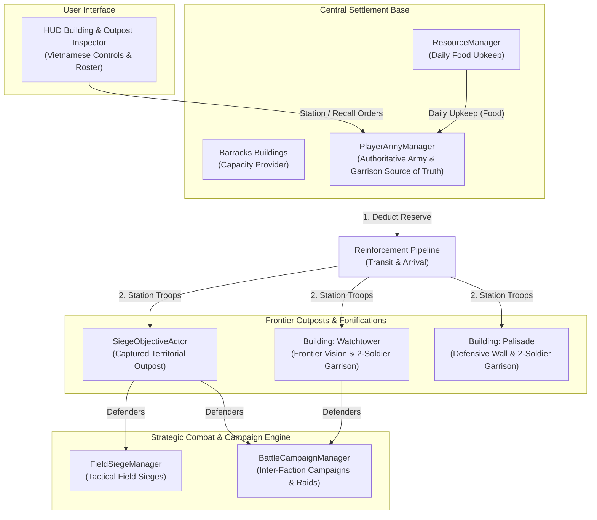

# PACKAGE 3A — TERRITORIAL OUTPOST GARRISONING & REINFORCEMENT
**Authoritative Technical Specification & Implementation Plan**  
**Project:** KINGDOMS UNBOUND  
**Engine:** Godot 4.7-stable  
**Milestone:** Milestone 3 — Strategic Gameplay Complete  
**Game Design Document References:** `docs/GDD.md` §6.3, §7.2, §10.1, §10.4, §10.5, §16.3  
**Target Feature Branch:** `feature/package-3a-outpost-garrison-reinforcement`  
**Base Commit:** `fff9011fc83ff032233cca399b0839e90f9e6cd8`  

---

## 1. EXECUTIVE SUMMARY & GAMEPLAY OBJECTIVE

### 1.1 Context & Strategic Need
In Milestone 2, the player achieved the capability to recruit soldiers (`PlayerArmyManager`), mobilize tactical squads (`TacticalMilitaryManager`), upgrade military equipment through Tier 3 smithing (`Package 2J`), and capture rival territory outposts via tactical field sieges (`Package 2G` / `FieldSiegeManager`).

However, captured territorial outposts (such as `outpost_rival_military`, `outpost_rival_merchant`, `outpost_neutral_tribe`) and defensive civic structures (`Watchtower`, `Palisade`) currently remain passive map entities without formal troop garrisons. Once conquered or erected:
1. Outposts project influence abstractly but have no stationed defenders.
2. If hostile warbands or enemy campaigns target a frontier outpost, it lacks an active stationed defensive force, making borders fragile and unreinforced.
3. The player cannot strategically distribute their military strength across frontier choke points or stage expeditionary forces closer to contested territories.

### 1.2 Package 3A Objectives
Package 3A delivers the complete **Territorial Outpost Garrisoning & Reinforcement System**:
- **Authoritative Outpost Garrison Model:** Enables the player to station soldiers at player-owned territorial outposts and defensive civic structures (`Watchtower`, `Palisade`), with strictly enforced per-outpost capacities.
- **Strict Soldier Identity & Total Conservation:** Every soldier in the realm is uniquely conserved: a soldier exists either in the central barracks reserve, in active reinforcement transit, or stationed at a specific outpost garrison. No soldier duplication, phantom clones, or unexplained disappearances under any gameplay condition.
- **Reinforcement Dispatch & Transit Pipeline:** Dispatches reinforcements from central barracks to frontier outposts with deterministic travel times and arrival synchronization.
- **Defensive Combat Integration:** Garrisoned soldiers actively participate in outpost defense during enemy raids, field sieges, and inter-faction campaigns, applying casualties exactly once and evicting surviving defenders cleanly if an outpost is sacked.
- **Integrated Supply & Upkeep:** Stationed garrison troops consume daily food upkeep, sharing kingdom-wide logistics while triggering localized morale impacts if supply lines fail.
- **HUD Outpost Inspection Panel:** Enhances HUD inspection with garrison soldier counts, capacity gauges, unit equipment rosters, and Vietnamese interactive stationing/recall controls.
- **Deterministic Persistence:** Full save/load serialization in `SaveManager` with backward-compatible migration for legacy save files.

---

## 2. SYSTEM ARCHITECTURE & COMPONENT RESPONSIBILITIES



### 2.1 Component Responsibilities
- **`PlayerArmyManager` (`scripts/military/player_army_manager.gd`):**
  - Serves as the central authoritative data owner for all player soldiers.
  - Maintains `soldier_count` (central reserve), `garrisons` dictionary (outpost allocations), and `active_reinforcements` (units in transit).
  - Enforces the global conservation invariant: `Total Recruited = Central Reserve + Garrisons + In-Transit`.
  - Enforces barracks capacity limits upon total recruitment.
  - Executes daily food upkeep across central troops and all garrisons.
  - Handles casualty application deterministically per outpost.
- **`FieldSiegeManager` (`scripts/combat/field_siege_manager.gd`):**
  - Tracks `SiegeObjectiveActor` outposts and territorial ownership.
  - Integrates player garrisons into outpost defense during hostile sieges.
  - Triggers garrison release / eviction upon outpost capture or loss.
- **`BattleCampaignManager` (`scripts/combat/battle_campaign_manager.gd`):**
  - Calculates defending power when an NPC campaign or raid targets a player outpost.
  - Directs combat casualties to the target outpost's garrison before affecting central reserves.
- **`BuildingSystem` (`scripts/economy/building_system.gd`):**
  - Defines garrison capacity for civic structures (`watchtower`: 2, `palisade`: 2).
  - Validates operational status (only `active` structures can hold garrisons; `damaged` or `under_construction` buildings cannot receive reinforcements).
- **`WorldView` (`scripts/world/world_view.gd`):**
  - Handles map interaction: left-clicking an outpost objective or defensive building selects it and opens the inspection panel.
  - Provides unified API hooks: `station_outpost_garrison()`, `recall_outpost_garrison()`, `dispatch_reinforcements()`.
- **`HUD` (`scripts/ui/hud.gd` & `scenes/ui/hud.tscn`):**
  - Displays garrison status, capacity bar, soldier equipment tier, and Vietnamese buttons (`[+ Điều Binh]`, `[- Rút Quân]`).
  - Displays localized status: "Trạng thái: An toàn" or "Đang bị bao vây".
- **`SaveManager` (`scripts/persistence/save_manager.gd`):**
  - Serializes and restores outpost garrisons and reinforcements under `player_army.garrisons` and `player_army.reinforcements`.
  - Provides complete backward compatibility with older save files lacking these sections.

---

## 3. OUTPOST GARRISON MODEL

### 3.1 Outpost Types & Capacities
1. **Territorial Control Points (`SiegeObjectiveActor`):**
   - Captured hostile outposts (`outpost_rival_military`, `outpost_rival_merchant`, `outpost_neutral_tribe`).
   - Default garrison capacity: 4 soldiers (configurable up to 6).
   - Must have `owning_faction_id == "player"` to receive player garrisons.
2. **Defensive Civic Buildings (`BuildingSystem`):**
   - `watchtower`: Garrison capacity = 2 soldiers.
   - `palisade`: Garrison capacity = 2 soldiers.
   - Must have `state == "active"` (buildings that are `under_construction`, `paused`, `damaged`, or `destroyed` cannot hold garrisons).

### 3.2 Soldier Data Schema & Identity Conservation
Stationed soldiers retain full individuality, equipment progression, and combat attributes:
```gdscript
{
    "soldier_id": "soldier_p_1",
    "equipment_tier": 2,          # Inherits Tier 1-3 from recruitment/upgrades
    "health": 100.0,              # Current HP
    "max_health": 100.0,
    "stationed_at": "outpost_rival_military",
    "stationed_day": 12
}
```
**The Global Soldier Conservation Invariant:**
$$\text{Total Recruited Soldiers} = \text{Central Reserve} + \sum_{o \in \text{Outposts}} \text{Garrison}(o) + \sum_{r \in \text{Reinforcements}} \text{InTransit}(r)$$
- When a soldier is stationed: Central Reserve decreases by 1; Outpost Garrison increases by 1.
- When a soldier is recalled: Outpost Garrison decreases by 1; Central Reserve increases by 1.
- When an outpost is sacked with casualties: Casualties are deducted exclusively from that outpost's garrison. Surviving soldiers retreat back to central reserve or are routed.
- Total kingdom soldiers never exceed Barracks Capacity:
$$\text{Total Recruited Soldiers} \le \text{Active Barracks} \times 5$$

---

## 4. GARRISON REINFORCEMENT PIPELINE

### 4.1 Dispatch & Transit Lifecycle
When the player reinforces an outpost from the central barracks:
1. **Validation (Fail-Closed):**
   - Outpost exists and is owned by `player`.
   - Outpost state is operational (`active` for buildings, `is_alive == true` for territorial objectives).
   - Outpost has vacant capacity: $\text{Current Garrison} + \text{In-Transit} < \text{Capacity}$.
   - Central barracks has available soldiers: $\text{Central Reserve} \ge \text{Dispatch Count}$.
2. **Atomic Dispatch:**
   - Central reserve is decremented immediately upon dispatch.
   - A reinforcement transit record is created:
     ```gdscript
     {
         "dispatch_id": "reinf_1",
         "outpost_id": "outpost_rival_military",
         "soldier_count": 2,
         "soldiers": [ ... ],
         "elapsed_hours": 0.0,
         "travel_hours": 3.0,
         "source_cell": Vector2i(32, 33),
         "target_cell": Vector2i(14, 14),
         "arrived": false
     }
     ```
3. **Simulation Transit:**
   - Travel time is calculated deterministically from grid distance:
     $$\text{Travel Hours} = \max(1.0, \text{Grid Distance} \times 0.1)$$
   - During hourly simulation ticks, `elapsed_hours += delta_hours`.
   - When `elapsed_hours >= travel_hours`, the reinforcement arrives.
4. **Arrival & Stationing:**
   - Soldiers are added to the outpost's active garrison.
   - Reinforcement record is cleared.
   - HUD is notified and emits event banner: `"Viện binh đã đến tiền đồn!"`.

---

## 5. DEFENSIVE COMBAT & SIEGE INTEGRATION

### 5.1 Outpost Defense Calculations
When an outpost is attacked by hostile forces:
- **Stationed Defense Force:** The outpost's stationed garrison forms the first line of defense.
- **Combat Multiplier:**
  $$\text{Effective Defense Strength} = \sum_{s \in \text{Garrison}} (1.0 \times \text{Equipment Multiplier}(s.\text{tier}) \times \text{Morale})$$
- If the outpost is a fortified structure (`Watchtower` or `Palisade`), defensive fortification bonuses apply.

### 5.2 Casualty Application Invariants
- Casualties inflicted by attacking forces are applied directly to the outpost's garrison records.
- Dead soldiers are permanently removed.
- Surviving soldiers remain stationed unless the outpost is completely overrun.
- **Sack / Ownership Transfer:** If the outpost is destroyed or conquered:
  - Any remaining garrison soldiers are evicted: surviving defenders retreat to central reserve or are taken as casualties according to campaign outcome.
  - The outpost's garrison is reset to zero for the player.
  - Zero ghost records remain in `PlayerArmyManager`.

---

## 6. OUTPOST UI & INSPECTION PANEL

### 6.1 HUD Inspection Layout
Under `BuildingInspectPanel/MarginContainer/VBoxContainer/ScrollContainer/ContentVBox`:
- **Garrison Section (`GarrisonSection`):**
  - `GarrisonTitleLabel`: `"Đồn Trú & Phòng Thủ Tiền Đồn"`
  - `GarrisonCountLabel`: `"Quân Đồn Trú: 2 / 4"`
  - `GarrisonTransitLabel`: `"Đang Tiếp Viện: 1 quân (còn 1.5 giờ)"` (hidden if none)
  - `GarrisonRosterContainer`: Dynamic list displaying each stationed soldier with equipment badge (Cấp 1/2/3) and health bar.
  - `GarrisonActionsHBox`:
    - `ReinforceBtn` (`Button`): `"[+ Điều Binh]"` — dispatches 1 soldier from central barracks.
    - `RecallBtn` (`Button`): `"[- Rút Quân]"` — recalls 1 soldier back to central reserve.
  - `GarrisonDefenseStatusLabel`: `"Trạng thái: An toàn"` (Green) or `"Trạng thái: Đang bị bao vây!"` (Red).

### 6.2 World Map Interaction
- Left-clicking on a captured `SiegeObjectiveActor` or defensive building opens the inspector with the garrison section active.
- Right-clicking with tactical units selected near a friendly outpost provides a context action to station selected units directly.

---

## 7. SUPPLY LINES & DAILY UPKEEP

### 7.1 Upkeep Logistics
- Stationed soldiers consume daily food rations at the standard rate:
  $$\text{Daily Upkeep} = 1\text{ Food per Soldier per Day}$$
- In `PlayerArmyManager.process_daily_upkeep(day)`:
  - Total food requirement is evaluated for all soldiers:
    $$\text{Total Food Required} = (\text{Central Reserve} + \text{Total Garrisoned} + \text{In-Transit}) \times 1$$
  - If central storage has adequate food:
    - Food is deducted atomically.
    - Central reserve and all outposts maintain `is_supplied = true` (Morale = 1.0).
  - If central storage lacks food:
    - All soldiers become `is_supplied = false` (Morale = 0.5).
    - Event banner warns: `"Không đủ lương thực duy trì quân đồn trú và quân dã chiến!"`.

---

## 8. SAVE/LOAD PERSISTENCE SCHEMA

### 8.1 Serialization Schema
Stored under `player_army` in the root save payload:
```json
{
  "player_army": {
    "soldier_count": 4,
    "equipment_tier": 2,
    "is_supplied": true,
    "last_upkeep_day": 5,
    "garrisons": {
      "outpost_rival_military": {
        "capacity": 4,
        "soldiers": [
          {"soldier_id": "soldier_1", "tier": 2, "health": 100.0, "max_health": 100.0},
          {"soldier_id": "soldier_2", "tier": 2, "health": 95.0, "max_health": 100.0}
        ]
      },
      "bld_watchtower_1": {
        "capacity": 2,
        "soldiers": [
          {"soldier_id": "soldier_3", "tier": 2, "health": 100.0, "max_health": 100.0}
        ]
      }
    },
    "reinforcements": [
      {
        "dispatch_id": "reinf_1",
        "outpost_id": "outpost_rival_military",
        "soldier_count": 1,
        "soldiers": [{"soldier_id": "soldier_4", "tier": 2, "health": 100.0, "max_health": 100.0}],
        "elapsed_hours": 1.0,
        "travel_hours": 2.5
      }
    ]
  }
}
```

### 8.2 Legacy Save Migration
- If `garrisons` or `reinforcements` are absent from loaded save files:
  - Default `garrisons` to `{}`.
  - Default `reinforcements` to `[]`.
  - All existing `soldier_count` remains in central reserve.
  - No crash, no data corruption, 100% fail-closed validation.

---

## 9. INVARIANTS & FAIL-CLOSED SAFEGUARDS

1. **Strict Soldier Conservation:** Under no circumstances can a soldier disappear or duplicate during stationing, recall, transit, or save/load.
2. **Capacity Bounding:** Outpost garrisons can never exceed their defined capacity ($N_{\text{garrison}} + N_{\text{transit}} \le \text{Capacity}$).
3. **Operational State Requirement:** Damaged, paused, or unconstructed buildings reject stationing requests fail-closed.
4. **Ownership Verification:** Only outposts owned by `player` can receive player garrisons. Rejection occurs fail-closed with localized reason.
5. **Idempotent Reinforcement Arrival:** Reinforcements cannot trigger multiple arrivals or leak records upon reload.
6. **Eviction on Loss:** If an outpost is conquered by an enemy faction, all player garrison records are evicted or eliminated; enemy outposts never retain phantom player soldiers.

---

## 10. PACKAGE 2M FOLLOW-UP FINDINGS

### 10.1 Finding A: Repair Transaction Lifetime & Concurrent Reservation Safety
- **Current Architecture:** `BuildingSystem.start_repair()` invokes `ResourceManager.reserve_cost()`, while `complete_repair()` calls `commit_cost()` and `cancel_repair()` calls `release_cost()`.
- **Concurrent Identical Costs:** When multiple buildings reserve identical repair costs (e.g. 5 Wood, 4 Stone):
  - `ResourceManager._direct_reservation_records` holds separate copies of each cost dictionary.
  - If Building A cancels and Building B completes, `release_cost()` and `commit_cost()` each consume one matching record sequentially. The aggregate reserved stock and current stock balance correctly.
- **Save/Load Reservation Finding:** In `SaveManager`, `save_to_file` exports available stock (`_current_stock - _reserved_stock`), while `load_from_file` resets reservations via `rm.reset_economy()`. Consequently, any repairs active during a save/load roundtrip lose their matching records in `_direct_reservation_records`.
- **Mitigation:** In Package 3A / future hardening, building records should store `repair_tx_id` and ensure reservations re-register cleanly if repairs persist across saves.

### 10.2 Finding B: Damage Thresholds & Formula Provenance
- `docs/GDD.md` §7.2 establishes the building state machine: `Planned` $\to$ `Under Construction` $\to$ `Active` $\to$ `Paused` $\to$ `Damaged` $\to$ `Destroyed`, and the core rule that only `Active` buildings perform functions.
- The quantitative parameters:
  - Max Health: $100$ HP
  - Damaged State Trigger: $\le 50$ HP
  - Repair Cost: $25\%$ of blueprint construction cost (minimum 1 per non-zero resource)
  - Repair Hours: $50\%$ of blueprint construction hours (minimum 2.0 hours)
  are **design implementation specifications** established during Package 2M to operationalize GDD §7.2 conservatively without arbitrary magic numbers.

### 10.3 Finding C: Damage Event Callers & Combat Integration Gap
- Audit of production callers confirms:
  - `SiegeObjectiveActor` and `TacticalUnit` receive combat damage via `take_damage()`.
  - `BuildingSystem.apply_damage()` and `WorldView.damage_building()` are currently called exclusively by direct repair test suites.
  - Natural combat/raids currently target units and siege objectives rather than civic settlement buildings directly. This constitutes an identified integration gap between the combat subsystem and civic structures to be connected in subsequent campaign packages.

---

## 11. TEST COVERAGE STRATEGY (25+ SCENARIOS)

Author `scripts/test/test_outpost_garrison_reinforcement.gd` covering:
1. `TC-OGR.01`: Outpost garrison data initialization and defaults.
2. `TC-OGR.02`: Legal soldier stationing at captured territorial outpost.
3. `TC-OGR.03`: Capacity limit enforcement on outpost garrison.
4. `TC-OGR.04`: Rejection of stationing when central barracks reserve is empty.
5. `TC-OGR.05`: Legal soldier stationing at Watchtower (capacity 2).
6. `TC-OGR.06`: Legal soldier stationing at Palisade (capacity 2).
7. `TC-OGR.07`: Rejection of stationing at damaged or paused building.
8. `TC-OGR.08`: Rejection of stationing at hostile or unowned outpost.
9. `TC-OGR.09`: Soldier recall from outpost back to central reserve.
10. `TC-OGR.10`: Rejection of recall when outpost garrison is empty.
11. `TC-OGR.11`: Strict global soldier conservation across multiple station/recall cycles.
12. `TC-OGR.12`: Equipment tier and health attribute preservation in garrison.
13. `TC-OGR.13`: Reinforcement dispatch and in-transit tracking.
14. `TC-OGR.14`: In-transit reinforcement capacity bounding (cannot over-dispatch).
15. `TC-OGR.15`: Reinforcement arrival synchronization after travel time elapsed.
16. `TC-OGR.16`: Daily food upkeep consumption across central + garrisoned troops.
17. `TC-OGR.17`: Upkeep failure handling: morale penalty without troop deletion.
18. `TC-OGR.18`: Outpost defense power calculation reflecting garrison strength.
19. `TC-OGR.19`: Casualty deduction from garrison records during outpost defense.
20. `TC-OGR.20`: Outpost conquest/sack cleanly evicts or eliminates garrison without leaks.
21. `TC-OGR.21`: Multiple simultaneous garrisons across multiple outposts.
22. `TC-OGR.22`: HUD inspection displays accurate garrison count and capacity.
23. `TC-OGR.23`: HUD station and recall button actions.
24. `TC-OGR.24`: SaveManager serialization and deserialization of garrisons.
25. `TC-OGR.25`: SaveManager backward compatibility with legacy save files.
26. `TC-OGR.26`: Idempotency of repeated stationing/reinforcement requests.

---

## 12. VERIFICATION & REGRESSION PLAN

1. Execute `test_outpost_garrison_reinforcement.gd` standalone via headless Godot.
2. Register test suite in `scripts/test/run_regression.ps1` (increasing suite count from 64 to 65).
3. Execute full regression runner and confirm 65/65 suites PASS with Exit Code 0.
4. Update `docs/planning/GAME_COMPLETION_ROADMAP.md`, `docs/planning/NEXT_GAMEPLAY_PACKAGE.md`, and `docs/WORKLOG.md`.
5. Stage and commit locally on branch `feature/package-3a-outpost-garrison-reinforcement`. DO NOT PUSH OR MERGE.
