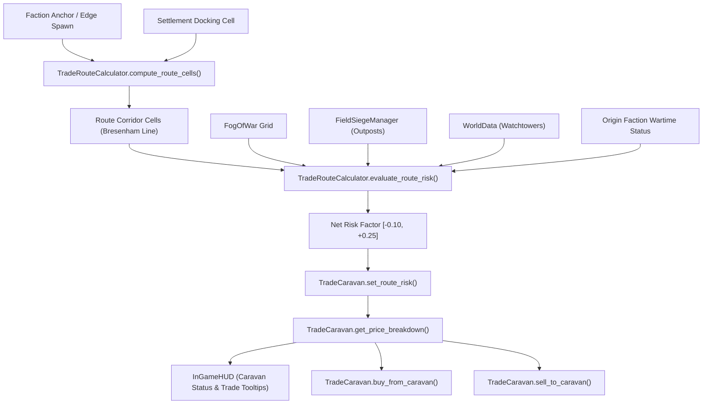

# KINGDOMS UNBOUND — PACKAGE 3C SPECIFICATION
## Dynamic Trade Route Risk & Caravan Economy (GDD §11.1, §11.2)
### Status: Implemented & Verified (Exit Gate Passed)

---

### 1. Document Overview & Authoritative Precedence

- **Document Version:** 1.0 (Implemented & Verified — Authoritative Baseline)
- **Target Milestone:** Milestone 3 — Strategic Gameplay Complete
- **Package Identifier:** `PACKAGE 3C — DYNAMIC TRADE ROUTE RISK & CARAVAN ECONOMY`
- **Parent Specifications:**
  - `docs/GDD.md` §11.1 (Thương nhân vãng lai & Thị trường — Visiting Merchants, Price Quotes, Spread, Non-Arbitrage)
  - `docs/GDD.md` §11.2 (Biến động giá & Cơ chế thị trường — 5 Dynamic Factors including Route Risk / Rủi ro tuyến đường)
  - `docs/GDD.md` §3.4 (Fog of War: Unexplored Wilderness)
  - `docs/GDD.md` §6.3, §7.1, §10.5 (Watchtowers & Territorial Outpost Coverage)
  - `docs/GDD.md` §16.3 (Architecture principles, transaction atomicity & persistence invariants)
- **Primary Objective:** Implement an authoritative, deterministic, and bounded dynamic route-risk model that evaluates corridor safety between merchant entry and settlement docking point based on Fog of War exploration, player territorial outpost and watchtower defensive coverage, hostile rival outposts, and origin faction wartime status. Ensure seamless integration with the dynamic pricing formula, 100% price quote vs transaction parity, positive bid/ask spread invariants, and robust save/load persistence.
- **Implementation Status:** **Implemented and Verified.** 15 dedicated scenarios with 178/178 assertions passed; full regression suite expanded to 67 suites.

---

### 2. GDD Traceability & Feature Classification Matrix

| Proposed Feature / Mechanic | Exact GDD Evidence | Existing Code Base | Classification | Authoritative Decision |
| :--- | :--- | :--- | :--- | :--- |
| **Route Risk as Core Market Factor** | GDD §11.2 explicitly specifies 5 dynamic market factors: "Cung cầu trong định cư, Mùa vụ & thiên tai, Tình hình chiến tranh ngoại giao, Rủi ro tuyến đường, Độ hiếm của tài nguyên." | In Package 2H, route risk was stubbed with a static 15% surcharge whenever `is_origin_at_war` was true. | **Explicit GDD requirement** | **Approved Scope:** Implement spatial corridor evaluation connecting caravan origin to docking location. |
| **Discrete Route Corridor Traversal** | GDD §3.1, §11.1: Discrete 64×64 isometric grid; caravans travel to designated settlement docking point. | Bresenham integer line algorithm in `TradeRouteCalculator.compute_route_cells()` traverses discrete grid cells deterministically without physics or floating point path drift. | **Derived technical implementation** | **Approved Scope:** Use discrete integer Bresenham line algorithm bounded by grid limits `[0, 63]`. |
| **Fog of War Danger Contribution ($U$)** | GDD §3.4, §11.2: Unexplored wilderness poses unknown threats and navigational hazards. | `FogOfWar.get_state(cell) == State.UNEXPLORED`. Ratio $U = \text{unexplored} / \text{total}$. | **Derived technical implementation** | **Approved Scope:** Unexplored cells contribute up to $+15\%$ surcharge ($+0.15 \times U$). |
| **Territorial Security Coverage ($S$)** | GDD §6.3, §7.1, §10.5: Active watchtowers ($r=15$) and player-owned outposts ($r=6$) secure surroundings and suppress regional danger. | `FieldSiegeManager` living player outposts ($r=6$) and `WorldData.buildings` active watchtowers ($r=15$). | **Derived technical implementation** | **Approved Scope:** Secured cells contribute up to $-10\%$ discount ($-0.10 \times S$). |
| **Hostile Outpost Interception ($H$)** | GDD §10.5, §11.2: Enemy outposts near routes intercept or threaten merchant passage. | `FieldSiegeManager` living non-player outposts (`rival_military` etc.) with $r=6$. | **Derived technical implementation** | **Approved Scope:** Hostile cells contribute up to $+10\%$ surcharge ($+0.10 \times H$). |
| **Wartime Status Factor ($W$)** | GDD §11.2: Tình hình chiến tranh ngoại giao increases risk to merchants from belligerent factions. | `active_caravan.is_origin_at_war`. | **Explicit GDD requirement** | **Approved Scope:** Adds $+10\%$ surcharge ($+0.10$) if origin faction is actively at war. |
| **Strict Risk Boundaries $[-10\%, +25\%]$** | GDD §11.1, §11.2: Market prices must remain bounded and economically meaningful. | Clamped in `clampf(net_risk, -0.10, 0.25)`. | **Derived technical boundary** | **Approved Scope:** Net risk strictly bounded to $[-0.10, +0.25]$ (maximum $10\%$ discount, maximum $25\%$ surcharge). |
| **Quote vs Transaction Parity** | GDD §11.1: Quoted trade prices must match executed transaction prices exactly. | Unified `TradeCaravan.get_price_breakdown()` feeds both UI and transaction methods (`buy_from_caravan`, `sell_to_caravan`). | **Explicit GDD requirement** | **Approved Scope:** Zero divergence between displayed HUD price and executed transaction cost. |
| **Positive Bid/Ask Spread Invariant** | GDD §11.1: Clear buy/sell distinction; zero risk-free arbitrage. | `final_sell_price >= 2`, `final_buy_price >= 1`, `final_buy_price <= final_sell_price - 1`. | **Explicit GDD requirement** | **Approved Scope:** Enforce spread $\ge 1\text{ Gold}$ across all risk levels. |
| **Bandit Combat / Raids / Escorts** | NOT in Milestone 3 scope. GDD §11 focuses on peaceful visiting trade economics. | No combat simulation during caravan travel. | **Excluded / Out-of-Scope** | **DEFERRED:** Deferred to future milestone. No physical caravan combat or escort AI. |

---

### 3. Mathematical Formula & Boundary Invariants

The authoritative net route risk factor $R_{\text{route}}$ is evaluated deterministically as:

$$R_{\text{raw}} = 0.15 \cdot U - 0.10 \cdot S + 0.10 \cdot H + (0.10 \text{ if } \text{is\_war} \text{ else } 0.0)$$

$$R_{\text{route}} = \text{clamp}(R_{\text{raw}}, -0.10, +0.25)$$

Where:
- $U = \frac{N_{\text{unexplored}}}{N_{\text{total}}} \in [0.0, 1.0]$: Ratio of route corridor cells currently in `State.UNEXPLORED` Fog of War.
- $S = \frac{N_{\text{secured}}}{N_{\text{total}}} \in [0.0, 1.0]$: Ratio of route corridor cells within player protective envelopes (Player Outposts $r=6$ or Active Watchtowers $r=15$).
- $H = \frac{N_{\text{hostile}}}{N_{\text{total}}} \in [0.0, 1.0]$: Ratio of route corridor cells within hostile enemy outpost interception zones ($r=6$).
- $\text{is\_war} \in \{\text{false}, \text{true}\}$: Origin faction wartime engagement status.

#### Price Calculation Integration:
$$\text{effective\_sell\_mult} = (1.0 - \text{opinion\_clamped} + R_{\text{route}}) \cdot M_{\text{market}}$$
$$\text{raw\_sell\_price} = \text{round}(\text{base\_sell} \cdot \text{effective\_sell\_mult})$$
$$\text{final\_sell\_price} = \max(2, \text{raw\_sell\_price})$$
$$\text{final\_buy\_price} = \text{clamp}(\text{raw\_buy\_price}, 1, \text{final\_sell\_price} - 1)$$

---

### 4. Architectural Modifications & Component Interactions

---

### 5. Verification & Acceptance Evidence

- **Dedicated Test Suite:** `scripts/test/test_trade_route_risk.gd` (15 scenarios, 178 assertions, 0 failures, Exit Code 0).
  - TC-TR.01: Bresenham Line Corridor Traversal (horizontal, diagonal, single cell).
  - TC-TR.02: Neutral Baseline Pricing Unchanged (0% risk preserves base prices).
  - TC-TR.03: Deterministic Route Risk (repeatable outputs given identical world state).
  - TC-TR.04: Unexplored Fog Surcharge (+15% max surcharge verified).
  - TC-TR.05: Player Outpost Security Discount (-10% max discount verified).
  - TC-TR.06: Player Watchtower Security (-10% discount verified).
  - TC-TR.07: Enemy Outpost Hostile Interception (+10% surcharge verified).
  - TC-TR.08: Outpost Ownership Transfer and Destruction (immediate real-time recalculation).
  - TC-TR.09: Quoted Prices Equal Executed Transaction Prices (100% parity).
  - TC-TR.10: No Double Modifier Application (idempotent read operations).
  - TC-TR.11: Failed Transactions Resource Conservation (fail-closed gold/inventory preservation).
  - TC-TR.12: Bid/Ask Spread Invariant ($\ge 1\text{ Gold}$ positive spread across all risk levels $[-10\%, +25\%]$).
  - TC-TR.13: Legacy Save Compatibility (missing fields default gracefully).
  - TC-TR.14: Save/Load Roundtrip (serialization and reconstruction of route risk summary).
  - TC-TR.15: WorldView Event-Driven Integration (reactive updates on outpost creation/destruction).
- **Subsystem Regression:**
  - `test_market.gd`: 26/26 tests passed (Exit Code 0).
  - `test_fog_of_war_reconnaissance.gd`: 81/81 assertions passed (Exit Code 0).
  - `test_field_siege.gd`: 98/98 assertions passed (Exit Code 0).
  - `test_save_load.gd`: 182/182 assertions passed (Exit Code 0).
- **Full Headless Regression:** All 67 registered suites in `run_regression.ps1` executed cleanly with Exit Code 0.
