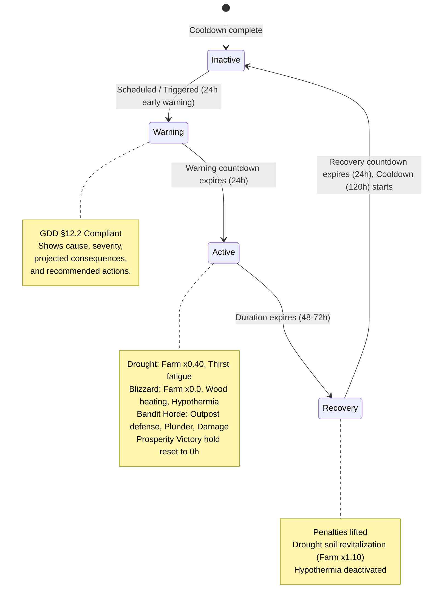

# PACKAGE 4A SPECIFICATION: ENDGAME CRISIS SCENARIOS & SETTLEMENT RESILIENCE

**Milestone:** Milestone 4 — Complete Endgame & Longevity  
**Status:** IMPLEMENTED & VERIFIED  
**Engine:** Godot 4.7-stable  
**Branch:** `feature/package-3a-outpost-garrison-reinforcement`  
**Reference Document:** `docs/GDD.md` §12.1, §12.2, §12.3, §1.1/Part XIII  

---

## 1. Executive Summary & Design Mission

Package 4A delivers the first major milestone of **Milestone 4 — Complete Endgame & Longevity**. It introduces meaningful late-game survival pressure through three distinct, deterministic crisis scenarios:
1. **Drought (Hạn Hán):** Agricultural disruption, 60% crop failure, water/food depletion pressure, citizen fatigue stress, post-drought soil recovery.
2. **Blizzard (Bão Tuyết):** Winter seasonal eligibility, 100% frozen agriculture, wood heating fuel consumption (2 Wood/hr), cold hypothermia damage and lethal freezing upon wood exhaustion, structural snow load wear.
3. **Bandit Horde (Đạo Tặc):** Prosperity-triggered militarized threat, border outpost garrison interception (Package 3A), standing army defense, bounded resource plundering (20% Food/Gold), and structural building damage (Package 2M durability).

Every crisis features a complete 5-stage lifecycle conforming strictly to GDD §12.2 rules for warnings, integrates seamlessly with `VictoryManager` prosperity hold invalidation (GDD §12.3), and provides full backward-compatible Save/Load persistence.

---

## 2. GDD Traceability Matrix

| Requirement / Rule | GDD Reference | Classification | Technical Implementation |
|---|---|---|---|
| **Crisis, Decline & Collapse States** | GDD §12.1 | Explicit Requirement | Implemented `STAGE_WARNING`, `STAGE_ACTIVE`, `STAGE_RECOVERY` lifecycle; connects to `VictoryManager` collapse triggers. |
| **Warning Communication Rules** | GDD §12.2 | Explicit Requirement | Warning banner displays Title, Root Cause, Severity Level, Projected Consequences, and Recommended Counterplay Actions. |
| **Prosperity Victory Hold Invalidation** | GDD §12.3 | Explicit Requirement | `VictoryManager.evaluate_prosperity_conditions()` checks `is_crisis_active()`. Active crisis invalidates continuous 5-day hold. |
| **Summer Drought Disruption** | GDD §1.1 / §12.1 | Explicit Requirement | Summer season eligibility. Reduces farm production multiplier to 0.40. Adds +0.5 fatigue/hr to working citizens. |
| **Winter Blizzard & Cold Hazards** | GDD §1.1 / §12.1 | Explicit Requirement | Winter season constraint. Farms frozen (0.0). Consumes 2 Wood/hr for heating. Cold hypothermia (-1 HP/hr) when wood is 0. |
| **Bandit Horde Militarized Raids** | GDD §1.1 / §12.1 | Explicit Requirement | Reuses territorial outposts and garrisons (Package 3A). Outposts intercept horde before reaching settlement. |
| **Building Damage & Maintenance** | GDD §7.2 / P2M | Existing Reused | Reuses `BuildingSystem.apply_damage()` for structural wear during blizzards and breached bandit raids. |
| **Save/Load Compatibility** | GDD §12.1 / P8 | Existing Reused | Structured `crisis_manager` section in `SaveManager` with safe fallback defaults for legacy saves. |
| **Meta-Unlocks / Legacy Points** | Milestone 4B | Excluded Scope | **DEFERRED TO PACKAGE 4B:** No legacy points expenditure, meta-perks, or world modifier selection in Package 4A. |

---

## 3. Architecture & State Machine



---

## 4. Scenario Mechanics & Mathematical Baselines

### 4.1. Drought (Hạn Hán)
- **Eligibility:** Summer (`season_index == 1`). Cannot trigger in Winter.
- **Warning Duration:** 24 simulation hours.
- **Active Duration:** 72 simulation hours (3 game days).
- **Modifiers:**
  - Farm production multiplier: $\times 0.40$ (60% crop failure).
  - Working citizen fatigue: $+0.5$ fatigue per hour.
- **Recovery Duration:** 24 simulation hours.
  - Farm production multiplier: $\times 1.10$ (+10% post-rain soil revitalization).
- **Counterplay:** Rely on grain reserves, buy food from visiting merchant caravans (Package 3C), redirect labor.

### 4.2. Blizzard (Bão Tuyết)
- **Eligibility:** Winter (`season_index == 3`). Cannot trigger in Spring/Summer/Autumn.
- **Warning Duration:** 24 simulation hours.
- **Active Duration:** 48 simulation hours (2 game days).
- **Modifiers:**
  - Farm production multiplier: $\times 0.0$ (fields frozen).
  - Outdoor citizen fatigue multiplier: $\times 1.50$ (+50% cold fatigue).
  - Heating Wood Consumption: 2 Wood per hour deducted from `ResourceManager`.
  - Hypothermia: If Wood stock reaches 0, `cold_hypothermia_active = true`. Citizens lose 1.0 HP/hr. Lethal freezing causes death with cause `"hypothermia_or_cold"`.
  - Snow Load Wear: Every 12 hours, 1 random building takes 2 damage via `BuildingSystem.apply_damage()`.
- **Counterplay:** Stockpile Wood and Food during Autumn, keep builders active for maintenance repairs.

### 4.3. Bandit Horde (Đại Họa Đạo Tặc)
- **Eligibility:** Mid/Late game (Day $\ge 10$, Population $\ge 15$ or Treasury $\ge 350$).
- **Warning Duration:** 24 simulation hours.
- **Threat Strength:** 8 to 14 bandits (seeded random based on settlement prosperity).
- **Interception Resolution:**
  1. **Phase 1: Outpost Garrisons (Package 3A):**
     - Each garrison soldier intercepts up to 2 bandits.
     - Outposts suffer 1 casualty per 3 bandits defeated (`apply_outpost_casualties`).
     - If garrison strength $\ge$ horde threat, horde is routed at the border!
  2. **Phase 2: Settlement Field Defense (Player Army):**
     - Remaining bandits are engaged by standing field army (`soldier_count`).
     - Each field soldier eliminates up to 2 bandits, suffering standard casualties (`remove_casualties`).
  3. **Phase 3: Settlement Breach Consequences:**
     - Food Plunder: $\min(\text{Food} \times 0.20, 100)$.
     - Gold Plunder: $\min(\text{Gold} \times 0.20, 150)$.
     - Building Damage: Up to 2 non-TownHall buildings suffer 25 damage each.
     - Citizen Morale: $-10.0$ morale across all living citizens.
- **Soldier Conservation Invariant:** $\text{Initial Soldiers} = \text{Remaining Soldiers} + \text{Casualties}$. No phantom soldiers lost or created.

---

## 5. Persistence & Schema Compatibility

### 5.1. Schema Format (`crisis_manager` section)
```json
{
  "crisis_manager": {
    "version": 1,
    "current_crisis_type": "drought",
    "current_stage": "active",
    "warning_hours_remaining": 0.0,
    "active_hours_remaining": 48.0,
    "recovery_hours_remaining": 0.0,
    "cooldown_hours_remaining": 0.0,
    "crisis_seed": 16385,
    "rng_state": "1234567890",
    "total_crises_faced": 1,
    "total_crises_survived": 0,
    "active_crisis_data": { ... },
    "cold_hypothermia_active": false,
    "last_raid_result": { ... }
  }
}
```

### 5.2. Legacy Compatibility
When loading a legacy save without `"crisis_manager"`:
- Deserialization safely initializes `current_crisis_type = CRISIS_NONE` and `current_stage = STAGE_INACTIVE`.
- Multipliers default to 1.0. Zero runtime exceptions.

---

## 6. Verification & Test Evidence Summary

- **Dedicated Test Suite:** `scripts/test/test_endgame_crisis.gd`
  - Assertions Passed: **92 / 92** (100% pass rate).
  - Scenarios: Initial state, Warning countdown, Drought, Blizzard hypothermia & wood consumption, Seasonal eligibility, Bandit Horde outpost interception, Settlement breach consequences, VictoryManager hold invalidation, Save/Load roundtrip, Legacy fallback, Seed determinism, Resource safety, Multi-outpost soldier conservation.
- **Related Subsystem Regressions:**
  - `test_victory_and_collapse.gd`: **All Phase 7 tests passed** (Exit code 0).
  - `test_building_damage_repair.gd`: **172 / 172 assertions passed** (Exit code 0).
  - `test_outpost_garrison_reinforcement.gd`: **171 / 171 assertions passed** (Exit code 0).
  - `test_save_load.gd`: **182 / 182 assertions passed** (Exit code 0).
  - `test_trade_route_risk.gd`: **178 / 178 assertions passed** (Exit code 0).
  - `test_all_scripts_load.gd`: **138 / 138 scripts compiled cleanly** (Exit code 0).
- **Full Regression Runner:** `scripts/test/run_regression.ps1`
  - Total Suites Tested: **68 / 68**
  - Passed: **68**
  - Failures: **0** (Exit code 0)
- **GUI Live Acceptance:** `scripts/test/visual_package_4a_live_acceptance.gd`
  - Hardware Execution: D3D12 Forward+ on NVIDIA GeForce RTX 3050 Ti Laptop GPU.
  - Screenshots Captured in `scratch/visual_validation/package_4a_live/`:
    1. `01_peacetime_world_and_hud.png`
    2. `02_drought_warning_banner.png`
    3. `03_drought_active_consequences.png`
    4. `04_blizzard_hypothermia_alert.png`
    5. `05_bandit_horde_outpost_interception.png`
    6. `06_crisis_recovery_banner.png`
