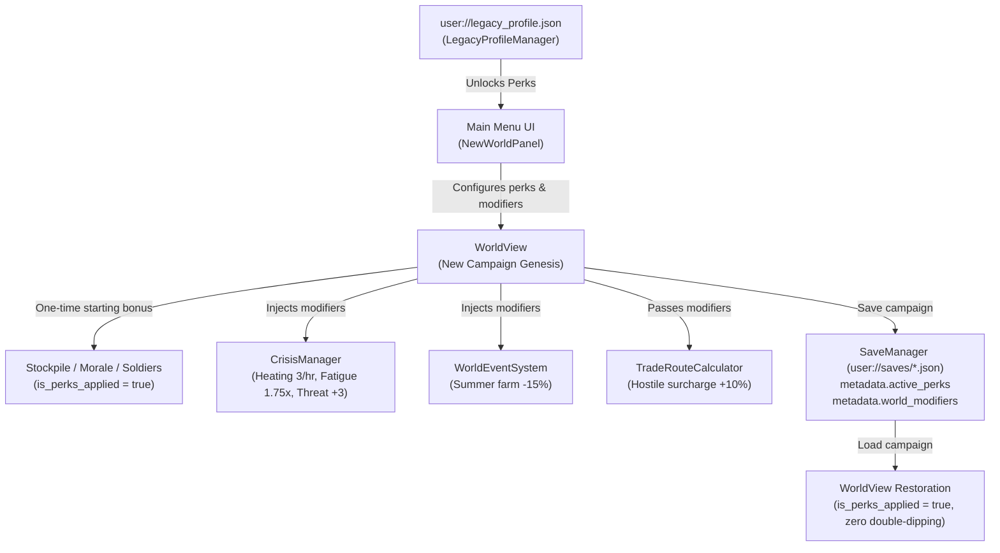

# PACKAGE 4B SPECIFICATION: LEGACY META-UNLOCKS & WORLD MODIFIERS

**Milestone:** Milestone 4 — Complete Endgame & Longevity  
**Status:** IMPLEMENTED & VERIFIED  
**Engine:** Godot 4.7-stable  
**Branch:** `feature/package-3a-outpost-garrison-reinforcement`  
**Reference Documents:** `docs/GDD.md` §12.4, §12.5, Part XIII (§13.1–§13.3), `docs/planning/GAME_COMPLETION_ROADMAP.md` line 276  

---

## 1. Executive Summary & Design Mission

Package 4B delivers the second and final major workstream of **Milestone 4 — Complete Endgame & Longevity**. It introduces a persistent cross-campaign meta-progression architecture and campaign customization system:

1. **Decoupled Persistent Meta-Progression Profile (`user://legacy_profile.json`):**
   - Independent of individual campaign save slots (`user://saves/*.json`).
   - Strict mathematical balance invariant:
     $$\text{legacy\_balance} = \text{lifetime\_legacy\_earned} - \text{lifetime\_legacy\_spent}$$
   - Anti-exploit protection preventing duplicate claims from repeated save reloading.
   - Fail-closed atomic write operations with automatic `.bak` and `.bak.old` backup reconciliation.

2. **Unlockable Starting Perks:**
   - Permanent unlock via Legacy Points (LP) in the cross-campaign profile.
   - Explicit prerequisite progression tree.
   - Applied exactly once upon campaign genesis with zero re-application on subsequent Save/Load cycles.

3. **World Modifiers (Campaign Mutators):**
   - Selected at new campaign creation.
   - Stored in world metadata and serialized into save files.
   - Influence environmental and strategic subsystems (CrisisManager, WorldEventSystem, TradeRouteCalculator).

---

## 2. Catalog Specifications

### 2.1 Starting Perks Catalog

| Perk ID | Name (Việt) | LP Cost | Prerequisite | Effect Description | Application Point |
|---|---|---|---|---|---|
| `starter_grain` | Kho Lương Ban Đầu | 50 LP | None | +50 Food added to starting settlement stock (150 -> 200). | Campaign genesis in `WorldView._apply_starting_perks_and_modifiers` |
| `master_carpenter` | Thợ Mộc Bậc Thầy | 75 LP | None | +40 Wood (120 -> 160) and +10 Tools (15 -> 25) added to starting stock. | Campaign genesis in `WorldView._apply_starting_perks_and_modifiers` |
| `hardened_outposts` | Tiền Đồn Kiên Cố | 100 LP | `master_carpenter` | +20 Metal (20 -> 40) and +2 starter soldiers (PlayerArmyManager) ready at Townhall. | Campaign genesis in `WorldView._apply_starting_perks_and_modifiers` |
| `pioneer_spirit` | Tinh Thần Khai Hoang | 120 LP | `starter_grain` | +10 starting Morale across all initial citizens (70.0 -> 80.0). | Campaign genesis in `WorldView._apply_starting_perks_and_modifiers` |

### 2.2 World Modifiers Catalog

| Modifier ID | Name (Việt) | Subsystem Affected | Rule & Multiplier | Behavior |
|---|---|---|---|---|
| `arid_realm` | Vùng Đất Cằn Cỗi | `WorldView`, `WorldEventSystem` | -20 starting Wood (120 -> 100). -15% Summer Farm production multiplier ($1.20 \to 1.02$). | Limits early timber stockpile and suppresses peak summer agricultural surplus. |
| `harsh_winters` | Mùa Đông Khắc Nghiệt | `CrisisManager` | Heating demand increased from 2 to 3 Wood/hour during blizzards. Outdoor cold fatigue increased from 1.50x to 1.75x (+25% extra penalty). | Severe strain on timber economy and citizen physical stamina during winter blizzards. |
| `restless_bandits` | Thổ Phỉ Lộng Hành | `CrisisManager`, `TradeRouteCalculator` | Bandit raid base threat level increased by +3 (11..17). Trade route risk increased by +0.10 (+10% risk surcharge). | Increases militarized border pressure and merchant pricing surcharges across all overland routes. |

---

## 3. Subsystem Integration & Persistence Architecture

### 3.1 Persistence & Save/Load Invariants
- `SaveManager.serialize_world_state()` captures:
  - `metadata.active_perks`: Array of active perk IDs.
  - `metadata.world_modifiers`: Array of active modifier IDs.
  - `metadata.difficulty`: Difficulty string.
- `SaveManager.apply_loaded_state_to_world()` restores these arrays and sets:
  - `world_view.is_perks_and_modifiers_applied = true`
- This ensures that one-time resource grants (+50 Food, +40 Wood, etc.) are **never** reapplied when loading an existing campaign save file.
- Backward compatibility: Saves lacking `active_perks` or `world_modifiers` cleanly default to empty arrays `[]`.

---

## 4. Verification & Test Coverage Matrix

Dedicated test suite: `scripts/test/test_legacy_meta_progression.gd` (17 scenarios, 82 assertions, Exit Code 0).

| Scenario | Objective | Assertions | Status |
|---|---|---|---|
| **Scenario 1** | Catalog Definitions (Perks & Modifiers) | 13 | PASS |
| **Scenario 2** | Insufficient Balance Fail-Closed Rejection | 6 | PASS |
| **Scenario 3** | Unmet Prerequisite Rejection (`hardened_outposts` without `master_carpenter`) | 5 | PASS |
| **Scenario 4** | Successful Purchase & Duplicate Purchase Prevention | 15 | PASS |
| **Scenario 5** | Atomic Disk Save Failure Memory Rollback | 5 | PASS |
| **Scenario 6** | `starter_grain` (+50 Food) Campaign Genesis Application | 1 | PASS |
| **Scenario 7** | `master_carpenter` (+40 Wood, +10 Tools) Application | 2 | PASS |
| **Scenario 8** | `hardened_outposts` (+20 Metal, +2 Soldiers) Application | 2 | PASS |
| **Scenario 9** | `pioneer_spirit` (+10 Morale) Citizen Application | 1 | PASS |
| **Scenario 10** | `arid_realm` (-20 Wood, -15% Summer Farm) Modifier Application | 3 | PASS |
| **Scenario 11** | `harsh_winters` (3 Wood/hr, +25% Extra Fatigue) Blizzard Impact | 3 | PASS |
| **Scenario 12** | `restless_bandits` (+3 Threat, +10% Route Risk) Impact | 2 | PASS |
| **Scenario 13** | Additive Combination of Perks and Modifiers (`master_carpenter` + `arid_realm`) | 1 | PASS |
| **Scenario 14** | Save/Load Roundtrip & Zero Perk Double-Application | 7 | PASS |
| **Scenario 15** | Cross-Campaign Isolation (No Modifier Leakage between saves) | 2 | PASS |
| **Scenario 16** | Legacy Save Compatibility (Missing Perks/Modifiers default to empty) | 3 | PASS |
| **Scenario 17** | Main Menu UI Wiring, Selection & Real-Time Profile Refresh | 8 | PASS |
